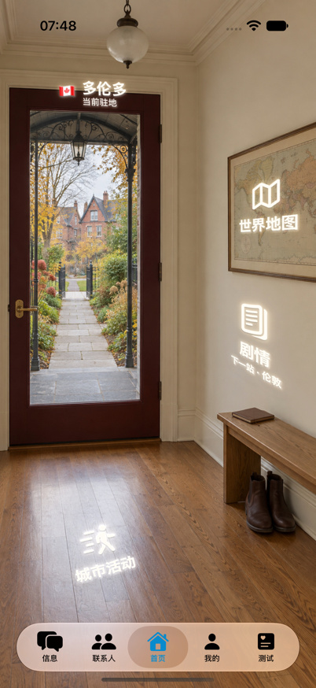
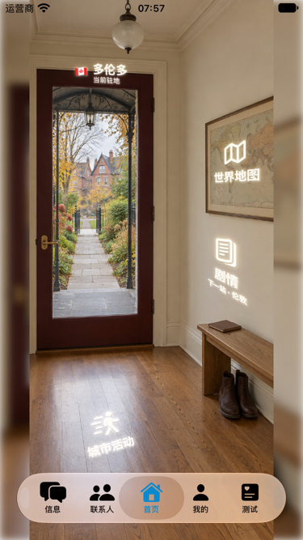

# 情景验收记录：多伦多首页 / 重制 v2

## 身份与状态

- 状态：可交付（本版可见结构及应用范围验收通过）；2026-09-10，Codex，c955 工作树。
- 源图：`/Users/tiantian/.codex/generated_images/01a0859e-bb0c-72c2-9ce9-ed128fb823a1/exec-b57aae30-00a4-4a34-b7e3-f57d91f0c9a7.png`；SHA256 `7cf5a9ad4b49332428c3ce50dcb69ff79c9625a7bc1b0fc4eee7e55b0a7d4bca`；原生 [853, 1844]。
- 完整提示词：`Assets/HomeScenes/Replacement-2026-09-10/toronto-v2-prompt.txt`；内置 image_gen，独立文生图，未传任何图片参数。失败后从新文字独立生成，未图生图。
- 运行图：`App/Assets.xcassets/home_city_toronto.imageset/home_city_toronto.jpg`；SHA256 `aed0ac97a1764b5192e59245dc565e915389fcfd9012c67f2e6bb42420e42402`；[853, 1844]。
- 唯一处理：原生中心裁切 `{'x': 0, 'y': 0, 'width': 853, 'height': 1844}`，Pillow JPEG quality=95, subsampling=0；无放大、无生成修补。
- 已阅读 activity-scene-visual-acceptance.md 全部规范/拒收登记、首页最新审计和模板；前版 2426f42 已退回，本城问题 H-11 已按新版本复核；最终几何单测通过9/9。

## G0/G1：证据和空间决策

| 真实来源/具体图片 | 实际观察结构 | 设计推断 | 使用范围 |
| --- | --- | --- | --- |
| [https://www.toronto.ca/explore-enjoy/history-art-culture/museums/spadina-museum/](https://www.toronto.ca/explore-enjoy/history-art-culture/museums/spadina-museum/)；[实际查看照片](https://www.toronto.ca/wp-content/uploads/2020/12/8c46-social-banner_SP.jpg) | Historic residence, iron canopy on side posts, stone landing and garden setting. | Simplified level stone landing/path -> open gate -> distant street/gabled brick houses. Remove uncertain elevated garden in v1; not a replica of Spadina. | 只参考结构；未随包或传给生成器 |

- 镜头：室内站姿，面向玄关墙与门；约 1.5m 眼高仅为设计假设，不伪称真实照片测量。近景门、地面、远侧建筑保持同一观察者关系。
- 尺度：普通约 2m 门高、0.45m 换鞋凳仅为设计假设；审核的是图中相互比例，不宣称恢复建筑施工尺寸。
- 门可关闭；玻璃近乎贯穿门高，近侧落脚地面明确可见；不靠闭门遮挡证明动线。
- 家具在门旁墙下；住客从室内接近凳子坐着换鞋/取笔记本，再起身开门离开，不需越过家具或穿越玻璃。
- S1 临窗坐姿/人物、S2 摊位/店员不适用：静态无人住宅玄关。G3/M1–M3 不适用：无视频、人物运动或循环合成。
- 禁用：重复锁具、中央廊柱堵出口、无来由升高的庭院、门口直接落入车道、无承重家具、无法解释的物体、UI 掩盖结构缺陷。

| 物品 | 用途/操作 | 支撑与尺度 | 入口 |
| --- | --- | --- | --- |
| 带框地图 | 墙上普通装饰/旅行参考，不作为真实导航测绘 | 框与墙共面，普通尺寸，非巨型道具 | 世界地图 |
| 换鞋凳、鞋 | 住客坐下换鞋；从室内拿取并归位 | 凳脚接地、鞋成对、不占门洞 | 剧情放邻近空墙，不把图文塞进小笔记本 |
| 口袋笔记本 | 从凳面拿起读写再放回 | 闭合书脊/书页、与凳面接触 | 无 |
| 门/门框、地面 | 正常出入与站立 | 单套门把手与对侧铰链、正常门框 | 城市名称沿门楣，城市活动沿地面 |

## G2–G4：逐项结果

| 检查项 | 结果 | 本版可观察证据 |
| --- | --- | --- |
| 整图空间第一印象 | 通过 | 封闭室内、普通玄关、门与地面清楚，整图已实际查看 |
| 近侧门槛/平台/通道 | 通过 | Simplified level stone landing/path -> open gate -> distant street/gabled brick houses. Remove uncertain elevated garden in v1; not a replica of Spadina. |
| 门框/锁具/承重 | 通过 | 一组常规门把、对侧铰链；框连续，未见重复把手或虚假旁门 |
| 凳子与地面 | 通过 | 支撑和接触阴影可见，鞋在凳下；不是悬浮台面 |
| 物体尺度/用途 | 通过 | 地图、鞋、闭合小本与常规凳子比例协调；无为按钮生造巨物 |
| 玻璃/反射/遮挡 | 通过 | 透过玻璃可见自身近地面；反光未形成第二条街道或矛盾开口 |
| 清晰度/虚化 | 通过 | 已查看原生五区，近景结构清晰，未用后处理虚化遮错 |
| 原生分区复查 | 通过 | `build/HomeReplacementReview/toronto-v2-{upper-left,upper-right,middle-left,middle-right,lower}.png`，按固定顺序逐一实际查看 |
| S1/S2、动态合成、M1/M2/M3 | 不适用 | 无人住宅静态图，无临窗桌台、摊位、视频或循环 |
| UI 投影/字形/可发现性 | 通过 | 标准/小屏截图逐张查看；原生发光图标与行动文字可辨，位于照片承载面内，未烘焙进背景 |
| 44pt 命中/边缘/相邻误触 | 通过 | 三入口逐城实际点击并返回；伦敦两尺寸额外测试左边内侧8pt按压，无误入相邻入口。四种视口44×44pt内接方形测试通过 |
| 裁切与最小屏可读性 | 通过 | 402×874、375×667逐城实际截图已检查；短屏保留整景，侧边沿用既有背景延展，未遮掉出入路线；图标/主文字清楚 |
| 点击/返回/按压 | 通过 | 两尺寸各15城中心点击全部通过；伦敦边缘0.12秒按压通过；爱丁堡修正后两尺寸均复测 |
| 前后台 | 通过（伦敦代表） | 标准/小屏伦敦启动后切系统桌面再恢复，场景截图和全部入口仍正常 |
| 减少动态/视频失败降级 | 无新增播放行为 | 本轮静态JPEG及坐标不引入视频或播放生命周期；未专项重跑系统减少动态设置，未冒称实测 |

## 问题 → 修正 → 复验

- 前版连同所有存疑图全部删除；旧图 SHA256 见 replacement-removals.json，失败生成哈希/原因见 rejections.json；遵从用户指令不保留拒收像素。
- 本版重新以实际参照审视近侧地面与完整出入路线；地图/图标、城市名称和活动入口不复用旧坐标。
- 全部五区已复查，未发现当前可见结构阻断；不声称单张生成照片能证明不可见结构或所有远处地图细字。
- H-11：原图近侧动线与物品复查、两尺寸实际截图及三个入口返回共同提供本版修正证据。地图/入口可读性不由生成成功或点击测试代替。

## 放行结论

可交付：原图、两尺寸应用视觉/交互及最终9项几何单测通过；当前可见范围阻断0、待修0、待证实0。未留用任何退回或存疑母版。手机实机未测。

## 本版应用证据与入口核查

- 标准屏 iPhone 17 Pro / iOS27 / 402×874pt：`build/HomeReplacementUI27.xcresult`。
- 小屏 SE3 模拟设备配置 / iOS27 / 375×667pt：`build/HomeReplacementUICompact27.xcresult`。
- 原始附件、设备UDID、截图哈希与缩放方式：`ui/evidence.json`；以下为实际截图等比缩至点尺寸，非合成示意图。

| 入口 | 标准屏图标/主字设计尺寸 | 小屏约等比尺寸 | 投影与可发现性 | 操作证据 |
| --- | --- | --- | --- | --- |
| 城市名称 / 门楣 | 20pt主字、11pt副字 | 主字约15pt | 城市与旗帜分明，未压进状态栏 | 城市辅助功能标签与区域ID一致 |
| 世界地图 / 相框 | 34pt图标、20pt主字 | 约26pt、15pt | 与同墙剧情共用测量平面，行动文字可辨 | 实际点击并从地图返回 |
| 剧情 / 邻近空墙 | 36pt图标、21pt主字 | 约27pt、16pt | 不占小笔记本、不被家具遮挡；新加坡移至地图上方避开瓷砖饰带 | 实际点击并从剧情返回 |
| 城市活动 / 地面 | 35pt图标、20pt主字 | 约26pt、15pt | 随地面投影，图标与文字不是压扁装饰 | 实际点击并从活动返回 |

尺寸为现有渲染器基准及小屏约0.75倍率，不伪称逐字实测像素；以截图核对最终轮廓。四种视口44pt命中几何另由测试验证。仅伦敦追加边缘按压与后台恢复，不把代表性覆盖写成每城专项覆盖。

- 最终几何证据：`build/HomeReplacementFinalGeometryClean27.xcresult`，9通过/0失败；清理工作树构建产物后重跑，未删除应用数据。完整覆盖与未测项见 `verification.json`。
