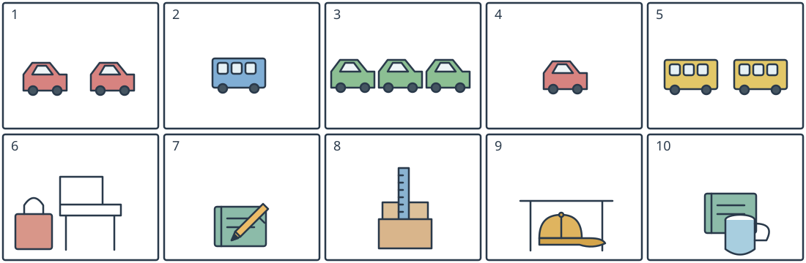

# 小四图词三：车辆数量与文具位置

## 学生题面

看全部十幅图选短语。第1—5题只用词库①，第6—10题只用词库②，不额外添加一次限制。

第一子组第1—5图用词库①；第二子组第6—10图用词库②。两个词库不合并。

词库①：

A. one red car

B. two yellow buses

C. a blue bus

D. two red cars

E. three green cars

词库②：

A. a cap under a table

B. a book behind a cup

C. a pencil on a book

D. a bag next to a chair

E. a ruler in a box

<!-- responses:start -->

1. 第1幅图
   A. one red car
   B. two yellow buses
   C. a blue bus
   D. two red cars
   E. three green cars

2. 第2幅图
   A. one red car
   B. two yellow buses
   C. a blue bus
   D. two red cars
   E. three green cars

3. 第3幅图
   A. one red car
   B. two yellow buses
   C. a blue bus
   D. two red cars
   E. three green cars

4. 第4幅图
   A. one red car
   B. two yellow buses
   C. a blue bus
   D. two red cars
   E. three green cars

5. 第5幅图
   A. one red car
   B. two yellow buses
   C. a blue bus
   D. two red cars
   E. three green cars

6. 第6幅图
   A. a cap under a table
   B. a book behind a cup
   C. a pencil on a book
   D. a bag next to a chair
   E. a ruler in a box

7. 第7幅图
   A. a cap under a table
   B. a book behind a cup
   C. a pencil on a book
   D. a bag next to a chair
   E. a ruler in a box

8. 第8幅图
   A. a cap under a table
   B. a book behind a cup
   C. a pencil on a book
   D. a bag next to a chair
   E. a ruler in a box

9. 第9幅图
   A. a cap under a table
   B. a book behind a cup
   C. a pencil on a book
   D. a bag next to a chair
   E. a ruler in a box

10. 第10幅图
   A. a cap under a table
   B. a book behind a cup
   C. a pencil on a book
   D. a bag next to a chair
   E. a ruler in a box

<!-- responses:end -->

## 作者核对

### 1：D

D：两辆红色小汽车。A同色仅一辆，B两黄巴士，C蓝巴士，E三绿车均数量/颜色/车型不符。

### 2：C

C：一辆蓝色巴士有三窗。A/D红小车、B黄巴士、E三绿小车不合。

### 3：E

E：三辆绿小车。A/D颜色红且一/二辆，B两黄巴士，C一蓝巴士均不合。

### 4：A

A：一辆红小车。D两辆不是一辆；B/C/E的颜色或车型数量不合。

### 5：B

B：两辆黄巴士；C只有一蓝巴士，A/D/E均小汽车不是黄巴士。

### 6：D

D：手提包在有靠背椅的一侧且不遮座。A帽桌、B书杯、C铅笔书、E尺盒无该包椅关系。

### 7：C

C：铅笔位于书封上方且接触其表面；B书在杯后不是铅笔在书上；A/D/E对象不同。

### 8：E

E：带刻度的直尺伸入盒口，盒前壁遮住下端。A帽桌、B书杯、C笔书、D包椅都不是尺盒。

### 9：A

A：帽子低于桌面且在两桌腿之间；B/C/D/E均不含帽子与桌。

### 10：B

B：书位于杯后，前景杯遮住书下部。C虽有书但关系为书上铅笔；A/D/E无书杯。

原创虚构材料；参照已核完整源模式，不沿用源正文或把原键当gold。所有候选逐空独立检查，不依赖排除已用项。作者自审不等独立教研、学生、商用或生产验证。
