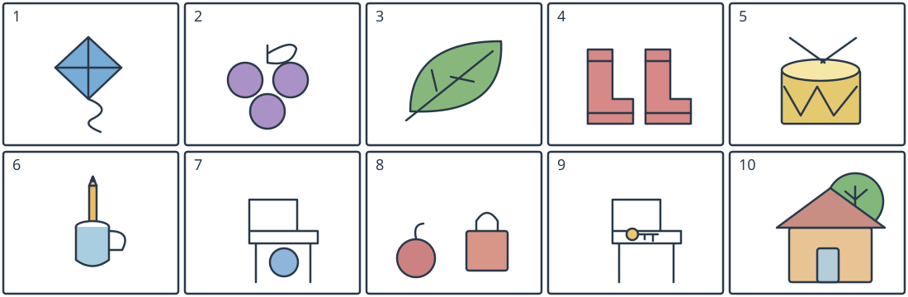

# 小四图词二：风筝与物品位置

## 学生题面

看全部十幅图选短语。第1—5题只用词库①，第6—10题只用词库②，不额外添加一次限制。

第一子组第1—5图用词库①；第二子组第6—10图用词库②。两个词库不合并。

词库①：

A. two red boots

B. a yellow drum

C. a green leaf

D. a blue kite

E. three purple grapes

词库②：

A. a key on a chair

B. a tree behind a house

C. an apple next to a bag

D. a pencil in a cup

E. a ball under a chair

<!-- responses:start -->

1. 第1幅图
   A. two red boots
   B. a yellow drum
   C. a green leaf
   D. a blue kite
   E. three purple grapes

2. 第2幅图
   A. two red boots
   B. a yellow drum
   C. a green leaf
   D. a blue kite
   E. three purple grapes

3. 第3幅图
   A. two red boots
   B. a yellow drum
   C. a green leaf
   D. a blue kite
   E. three purple grapes

4. 第4幅图
   A. two red boots
   B. a yellow drum
   C. a green leaf
   D. a blue kite
   E. three purple grapes

5. 第5幅图
   A. two red boots
   B. a yellow drum
   C. a green leaf
   D. a blue kite
   E. three purple grapes

6. 第6幅图
   A. a key on a chair
   B. a tree behind a house
   C. an apple next to a bag
   D. a pencil in a cup
   E. a ball under a chair

7. 第7幅图
   A. a key on a chair
   B. a tree behind a house
   C. an apple next to a bag
   D. a pencil in a cup
   E. a ball under a chair

8. 第8幅图
   A. a key on a chair
   B. a tree behind a house
   C. an apple next to a bag
   D. a pencil in a cup
   E. a ball under a chair

9. 第9幅图
   A. a key on a chair
   B. a tree behind a house
   C. an apple next to a bag
   D. a pencil in a cup
   E. a ball under a chair

10. 第10幅图
   A. a key on a chair
   B. a tree behind a house
   C. an apple next to a bag
   D. a pencil in a cup
   E. a ball under a chair

<!-- responses:end -->

## 作者核对

### 1：D

D：蓝色菱形风筝带尾线；A两红靴、B黄鼓、C绿叶、E三紫葡萄均非风筝。

### 2：E

E：三个紫色葡萄圆果带梗；A靴B鼓C叶D风筝的对象均不合。

### 3：C

C：带叶脉的绿色叶片；A/B/D/E分别靴鼓风筝葡萄。

### 4：A

A：两只红靴；B/C/D/E的物件都不是靴子，数量二亦明确。

### 5：B

B：黄鼓有鼓面、鼓身和鼓槌；A靴C叶D风筝E葡萄无鼓线索。

### 6：D

D：铅笔下端进杯口，杯前壁遮底；A椅上钥匙、B屋后树、C苹果包、E椅下球都无铅笔杯组合。

### 7：E

E：球在有靠背椅的座面以下/椅腿之间；A同有椅但物件是椅上钥匙；B/C/D对象均不同。

### 8：C

C：苹果与手提包相邻而不重叠；A钥匙椅、B树屋、D铅笔杯、E球椅不合。

### 9：A

A：钥匙在椅座上；E球在椅下不能代替钥匙；B/C/D没有该椅钥匙组合。

### 10：B

B：树冠/树干在房屋后，房屋遮住下部树干；A/C/D/E均无树屋空间关系。

原创虚构材料；参照已核完整源模式，不沿用源正文或把原键当gold。所有候选逐空独立检查，不依赖排除已用项。作者自审不等独立教研、学生、商用或生产验证。
