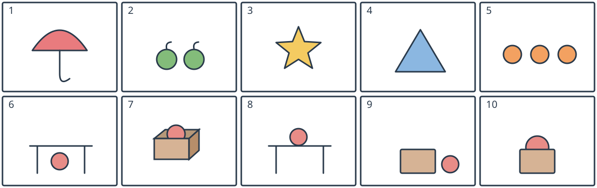

# 小四：两套独立词图配对

## 学生题面

看图，为每幅图选择相应词库中的一个字母。第1—5题用词库①，第6—10题用词库②。

第一子组：第1—5图共用词库①。第二子组：第6—10图共用词库②。两个词库彼此独立。

词库①：
A. a blue triangle
B. two green apples
C. a red umbrella
D. three orange balls
E. a yellow star

词库②：
A. a ball on a table
B. a ball behind a box
C. a ball under a table
D. a ball next to a box
E. a ball in a box

<!-- responses:start -->

1. 第1幅图
   A. a blue triangle
   B. two green apples
   C. a red umbrella
   D. three orange balls
   E. a yellow star

2. 第2幅图
   A. a blue triangle
   B. two green apples
   C. a red umbrella
   D. three orange balls
   E. a yellow star

3. 第3幅图
   A. a blue triangle
   B. two green apples
   C. a red umbrella
   D. three orange balls
   E. a yellow star

4. 第4幅图
   A. a blue triangle
   B. two green apples
   C. a red umbrella
   D. three orange balls
   E. a yellow star

5. 第5幅图
   A. a blue triangle
   B. two green apples
   C. a red umbrella
   D. three orange balls
   E. a yellow star

6. 第6幅图
   A. a ball on a table
   B. a ball behind a box
   C. a ball under a table
   D. a ball next to a box
   E. a ball in a box

7. 第7幅图
   A. a ball on a table
   B. a ball behind a box
   C. a ball under a table
   D. a ball next to a box
   E. a ball in a box

8. 第8幅图
   A. a ball on a table
   B. a ball behind a box
   C. a ball under a table
   D. a ball next to a box
   E. a ball in a box

9. 第9幅图
   A. a ball on a table
   B. a ball behind a box
   C. a ball under a table
   D. a ball next to a box
   E. a ball in a box

10. 第10幅图
   A. a ball on a table
   B. a ball behind a box
   C. a ball under a table
   D. a ball next to a box
   E. a ball in a box

<!-- responses:end -->

## 作者核对

### 1：C

图1是红伞，选C。A是蓝三角、B是两苹果、D是三球、E是星，物件不同。

### 2：B

图2有两个绿苹果，选B。A三角、C伞、D球、E星都非苹果。

### 3：E

图3为黄星，选E。A三角形边数/形状不同；B苹果、C伞、D球为别类物件。

### 4：A

图4为蓝三角，选A。B苹果、C伞、D球、E星均不是该三角形。

### 5：D

图5为三个橙球，选D。A蓝三角、B两绿苹果、C红伞、E黄星均不合物件与数量。

### 6：C

图6球在桌面以下、桌腿之间，C。A为桌上；B/D/E涉及箱子，图无箱。

### 7：E

图7打开的三维箱口内露出球上部，箱前壁遮住球下部，选E。A/C为桌；B应在箱外后方，D应在箱旁，两者都不在此箱口内部。

### 8：A

图8球在桌面上，A。C为桌下；B/D/E为箱子而图无箱。

### 9：D

图9球在箱右侧且不重叠，D。B为箱后、E箱内均与分离位置不符；A/C需桌。

### 10：B

图10球被箱上部遮挡、露出上半，位于箱后，B。D应侧旁不遮挡；E应显示箱前缘跨过内部球；A/C要桌。

原创虚构材料；参照完整源模式，所有候选逐空独立核对。作者自审不等独立教研、学生、商用或生产验证。
