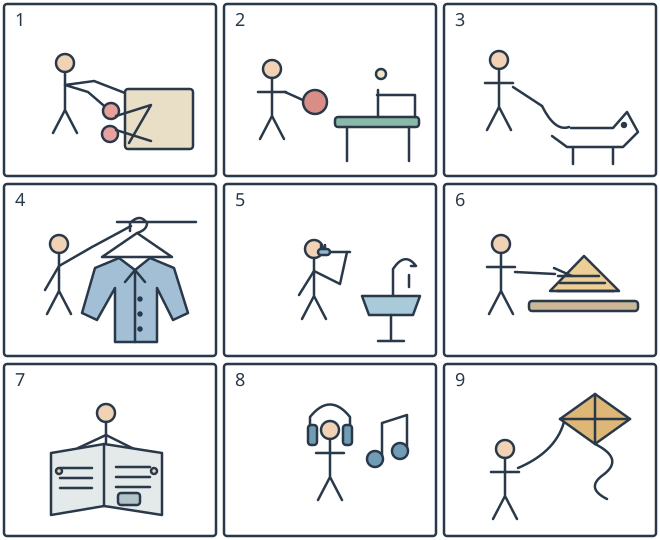

# 小六图词三：居家与活动的九个动作

## 学生题面

看全部九幅图，为每图从九个共享短语中选一个字母。逐图独立选择，不添加源未印的每项最多一次限制。

共享短语：

A. walk a dog

B. listen to music

C. hang a coat

D. make a sandwich

E. fly a kite

F. cut paper

G. brush your teeth

H. read a newspaper

I. play table tennis

<!-- responses:start -->

1. 第1幅图
   A. walk a dog
   B. listen to music
   C. hang a coat
   D. make a sandwich
   E. fly a kite
   F. cut paper
   G. brush your teeth
   H. read a newspaper
   I. play table tennis

2. 第2幅图
   A. walk a dog
   B. listen to music
   C. hang a coat
   D. make a sandwich
   E. fly a kite
   F. cut paper
   G. brush your teeth
   H. read a newspaper
   I. play table tennis

3. 第3幅图
   A. walk a dog
   B. listen to music
   C. hang a coat
   D. make a sandwich
   E. fly a kite
   F. cut paper
   G. brush your teeth
   H. read a newspaper
   I. play table tennis

4. 第4幅图
   A. walk a dog
   B. listen to music
   C. hang a coat
   D. make a sandwich
   E. fly a kite
   F. cut paper
   G. brush your teeth
   H. read a newspaper
   I. play table tennis

5. 第5幅图
   A. walk a dog
   B. listen to music
   C. hang a coat
   D. make a sandwich
   E. fly a kite
   F. cut paper
   G. brush your teeth
   H. read a newspaper
   I. play table tennis

6. 第6幅图
   A. walk a dog
   B. listen to music
   C. hang a coat
   D. make a sandwich
   E. fly a kite
   F. cut paper
   G. brush your teeth
   H. read a newspaper
   I. play table tennis

7. 第7幅图
   A. walk a dog
   B. listen to music
   C. hang a coat
   D. make a sandwich
   E. fly a kite
   F. cut paper
   G. brush your teeth
   H. read a newspaper
   I. play table tennis

8. 第8幅图
   A. walk a dog
   B. listen to music
   C. hang a coat
   D. make a sandwich
   E. fly a kite
   F. cut paper
   G. brush your teeth
   H. read a newspaper
   I. play table tennis

9. 第9幅图
   A. walk a dog
   B. listen to music
   C. hang a coat
   D. make a sandwich
   E. fly a kite
   F. cut paper
   G. brush your teeth
   H. read a newspaper
   I. play table tennis

<!-- responses:end -->

## 作者核对

### 1：F

F：剪刀双指环与交叉刀口贴着纸张，表现剪纸；不同于其余八活动。 其余八项在本图无必要对象/动作，不以排除已用项定答。

### 2：I

I：有球台/网/小球、人物持实心球拍，乒乓球而非其他候选。 其余八项在本图无必要对象/动作，不以排除已用项定答。

### 3：A

A：人物牵绳连着四足犬的项圈且犬在地面行走，遛狗；无其余活动器具。 其余八项在本图无必要对象/动作，不以排除已用项定答。

### 4：C

C：有带钩衣架和悬挂外套，人物抬手挂衣，区别其他活动。 其余八项在本图无必要对象/动作，不以排除已用项定答。

### 5：G

G：牙刷小刷头在人物嘴边、短柄握持；不是戴耳机或吃三明治。 其余八项在本图无必要对象/动作，不以排除已用项定答。

### 6：D

D：桌上有多层夹心面包、人物手放食材，做三明治；不是剪纸或读报。 其余八项在本图无必要对象/动作，不以排除已用项定答。

### 7：H

H：人物面前展开带双栏文字线与小图的报纸，注意是报纸版面而非地图/纸飞机。 其余八项在本图无必要对象/动作，不以排除已用项定答。

### 8：B

B：人物两耳为耳罩、头顶弧形耳机带，旁有音符，听音乐而非刷牙。 其余八项在本图无必要对象/动作，不以排除已用项定答。

### 9：E

E：手握牵引线连接空中风筝，线与风筝尾分开，放风筝而非挂外套/遛狗。 其余八项在本图无必要对象/动作，不以排除已用项定答。

原创虚构材料；参照已核完整源模式，不沿用源正文或把原键当gold。所有候选逐空独立检查，不依赖排除已用项。作者自审不等独立教研、学生、商用或生产验证。
