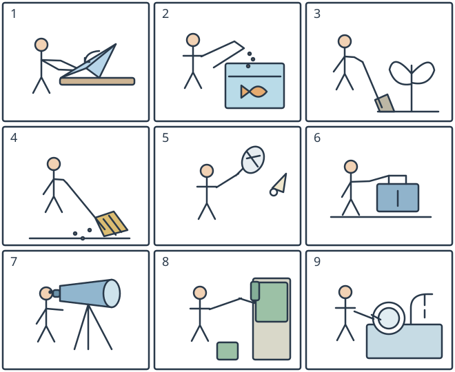

# 小六图词二：动手与帮忙的九个动作

## 学生题面

看全部九幅图，为每图从九个共享短语中选一个字母。逐图独立选择，不添加源未印的每项最多一次限制。

共享短语：

A. wash a plate

B. look through a telescope

C. fold a paper plane

D. carry a suitcase

E. plant a tree

F. paint a wall

G. feed a fish

H. play badminton

I. sweep the floor

<!-- responses:start -->

1. 第1幅图
   A. wash a plate
   B. look through a telescope
   C. fold a paper plane
   D. carry a suitcase
   E. plant a tree
   F. paint a wall
   G. feed a fish
   H. play badminton
   I. sweep the floor

2. 第2幅图
   A. wash a plate
   B. look through a telescope
   C. fold a paper plane
   D. carry a suitcase
   E. plant a tree
   F. paint a wall
   G. feed a fish
   H. play badminton
   I. sweep the floor

3. 第3幅图
   A. wash a plate
   B. look through a telescope
   C. fold a paper plane
   D. carry a suitcase
   E. plant a tree
   F. paint a wall
   G. feed a fish
   H. play badminton
   I. sweep the floor

4. 第4幅图
   A. wash a plate
   B. look through a telescope
   C. fold a paper plane
   D. carry a suitcase
   E. plant a tree
   F. paint a wall
   G. feed a fish
   H. play badminton
   I. sweep the floor

5. 第5幅图
   A. wash a plate
   B. look through a telescope
   C. fold a paper plane
   D. carry a suitcase
   E. plant a tree
   F. paint a wall
   G. feed a fish
   H. play badminton
   I. sweep the floor

6. 第6幅图
   A. wash a plate
   B. look through a telescope
   C. fold a paper plane
   D. carry a suitcase
   E. plant a tree
   F. paint a wall
   G. feed a fish
   H. play badminton
   I. sweep the floor

7. 第7幅图
   A. wash a plate
   B. look through a telescope
   C. fold a paper plane
   D. carry a suitcase
   E. plant a tree
   F. paint a wall
   G. feed a fish
   H. play badminton
   I. sweep the floor

8. 第8幅图
   A. wash a plate
   B. look through a telescope
   C. fold a paper plane
   D. carry a suitcase
   E. plant a tree
   F. paint a wall
   G. feed a fish
   H. play badminton
   I. sweep the floor

9. 第9幅图
   A. wash a plate
   B. look through a telescope
   C. fold a paper plane
   D. carry a suitcase
   E. plant a tree
   F. paint a wall
   G. feed a fish
   H. play badminton
   I. sweep the floor

<!-- responses:end -->

## 作者核对

### 1：C

C：桌面上把纸折成有机翼尖角的纸飞机，双手参与，非切纸或其他八活动。 其余八项的关键器具/动作与本图不符，不靠用剩候选定答。

### 2：G

G：鱼缸有鱼/水线，上方手撒小食粒，区别浇水/做饭，也无其余八项器具。 其余八项的关键器具/动作与本图不符，不靠用剩候选定答。

### 3：E

E：幼树根部在土线，人物持铲；不是给现成盆栽浇水，九候选中只有种树。 其余八项的关键器具/动作与本图不符，不靠用剩候选定答。

### 4：I

I：长柄扫帚触地、旁有尘点，扫地而非涂墙或洗盘。 其余八项的关键器具/动作与本图不符，不靠用剩候选定答。

### 5：H

H：人物手持网拍，空中羽毛球带羽裙；没有乒乓球台，区别其他候选。 其余八项的关键器具/动作与本图不符，不靠用剩候选定答。

### 6：D

D：人物的手接行李箱顶端把手，箱底离地，表现手提行李箱；不是花盆、水池、棋具或其余八候选活动。

### 7：B

B：人物眼侧对着带三脚架、前端圆镜筒的望远镜；不是相机或绘画工具。 其余八项的关键器具/动作与本图不符，不靠用剩候选定答。

### 8：F

F：墙板有已涂色块，人物拿滚筒向墙，不是扫地/种树；其余候选无滚筒墙面。 其余八项的关键器具/动作与本图不符，不靠用剩候选定答。

### 9：A

A：手持盘处于有水龙头的水池上，盘形双圆环明显，不是喂鱼或其他活动。 其余八项的关键器具/动作与本图不符，不靠用剩候选定答。

原创虚构材料；参照已核完整源模式，不沿用源正文或把原键当gold。所有候选逐空独立检查，不依赖排除已用项。作者自审不等独立教研、学生、商用或生产验证。
