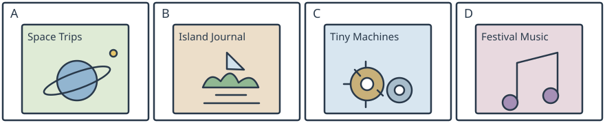

# 小六表格三：星球、海岛、机械与音乐

## 学生题面

阅读全部四个书栏、封面与折扣/配送/订购页脚，完成五题，每题三个选项。

### New titles for the reading corner

| Book | A: Space Trips | B: Island Journal | C: Tiny Machines | D: Festival Music |
| --- | --- | --- | --- | --- |
| About | A fictional crew visits three planets. A story told in pictures. | Read a child's notes about a boat journey between three islands. Each day has a small map. | Build small moving toys with card and wheels. Diagrams show how the parts fit. | Sing eight new songs for school celebrations. Each song has notes for a keyboard. |
| Pages | 56 | 48 | 72 | 40 |
| Usual price | 30 yuan | 26 yuan | 34 yuan | 22 yuan |

**Friday offer:** All four books are half price on Friday. Pay the usual price on other days. Delivery costs 5 yuan per order, whatever the number of books. Order at **cornerbooks.example**, a fictional classroom-shop address. Do not telephone the writers to order. All titles, stories and prices are fictional.

<!-- responses:start -->

1. Which book contains a child's notes about traveling between islands?
   A. Space Trips
   B. Festival Music
   C. Island Journal

2. Which book gives instructions for building moving toys?
   A. Tiny Machines
   B. Space Trips
   C. Island Journal

3. Which of these books has the most pages?
   A. Island Journal
   B. Tiny Machines
   C. Festival Music

4. On Friday, how much are Space Trips and Festival Music together, including one delivery fee?
   A. 31 yuan.
   B. 26 yuan.
   C. 36 yuan.

5. How should pupils order books from this shop?
   A. Telephone the writers.
   B. Go to the islands in the story.
   C. Use the stated shop website.

<!-- responses:end -->

## 作者核对

### 1：C

C是岛间船行日记及每日小图；A虚构星际故事非海岛，B节庆歌曲非旅行日记。

### 2：A

A小车纸卡与轮子、零件图示；B星际故事不是制作指南，C旅行日记不是组装说明。

### 3：B

A48、B72、C40页，B最大；价格26/34/22不是所问页数。

### 4：A

30/2+22/2+5=31选A；B漏配送；C两次配送，多收5。

### 5：C

页脚明确在线地址与不打给作者，C。A被否定；B故事目的地不是现实订购点。

原创虚构材料；参照已核完整源模式，不沿用源正文或把原键当gold。所有候选逐空独立检查，不依赖排除已用项。作者自审不等独立教研、学生、商用或生产验证。
