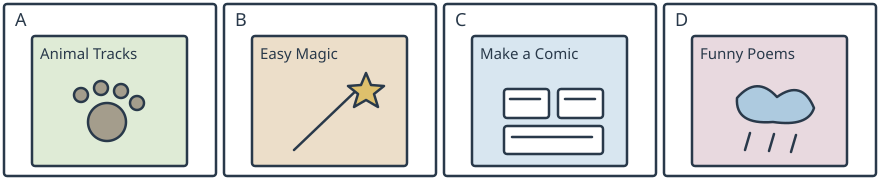

# 小六表格二：脚印、魔术、漫画与诗

## 学生题面

阅读全部四个书栏、封面与折扣/配送/订购页脚，完成五题，每题三个选项。

### Books to try this term

| Book | A: Animal Tracks | B: Easy Magic | C: Make a Comic | D: Funny Poems |
| --- | --- | --- | --- | --- |
| About | Match drawings of footprints to common animals. Learn where to look for tracks. | Try simple tricks with paper and string. Every step has a picture. | Draw characters and add speech bubbles. Finish a short comic of your own. | Read twelve short poems about rainy days, muddy shoes and funny pets. |
| Pages | 32 | 60 | 44 | 36 |
| Usual price | 12 yuan | 20 yuan | 16 yuan | 18 yuan |

**Wednesday offer:** All four books are half price on Wednesday. Pay the usual price on other days. Delivery costs 3 yuan per order, regardless of how many books it contains. Order at **readingshelf.example**, a fictional shop address. Orders are made online, not by telephone. These are fictional classroom-shop prices.

<!-- responses:start -->

1. Which book helps pupils draw characters and add speech bubbles?
   A. Animal Tracks
   B. Make a Comic
   C. Easy Magic

2. Which book can help a pupil identify animal footprints?
   A. Funny Poems
   B. Easy Magic
   C. Animal Tracks

3. Which of these books has the fewest pages?
   A. Animal Tracks
   B. Make a Comic
   C. Funny Poems

4. On Wednesday, how much are Easy Magic and Funny Poems together, including one delivery fee?
   A. 19 yuan.
   B. 25 yuan.
   C. 22 yuan.

5. When can pupils buy these books at half their usual price?
   A. On Friday.
   B. On Wednesday.
   C. On Tuesday.

<!-- responses:end -->

## 作者核对

### 1：B

B有draw characters/add speech bubbles；A辨认脚印、C纸线小魔术都非制作漫画。

### 2：C

C将脚印图与动物匹配；A短诗、B纸线小戏法不教辨脚印。

### 3：A

A32页小于B44和C36；不把价格数字误当页数，也不比较不在选项中的60页书。

### 4：C

20/2+18/2=19，一单配送3，总22选C。A漏配送；B多收一次配送。

### 5：B

页脚明确Wednesday半价，B；A/C其他日常价，不因熟悉历史稿的日期作答。

原创虚构材料；参照已核完整源模式，不沿用源正文或把原键当gold。所有候选逐空独立检查，不依赖排除已用项。作者自审不等独立教研、学生、商用或生产验证。
