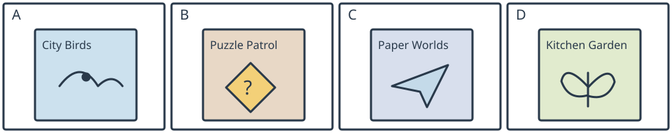

# 小六：四书表格与折扣阅读

## 学生题面

阅读四个完整书栏、四幅封面和底部价格/折扣/配送说明。完成五题，每题三个选项。

### Books for our class reading corner

| Book | A: City Birds | B: Puzzle Patrol | C: Paper Worlds | D: Kitchen Garden |
| --- | --- | --- | --- | --- |
| About | Learn to recognise common birds in a city park. Includes clear drawings. | Two children solve a mystery about a missing school bell. A story in six chapters. | Make paper models of houses, boats and bridges. Pictures show every step. | Grow herbs in small pots. Includes a weekly record page for your plants. |
| Pages | 48 | 64 | 40 | 56 |
| Usual price | 20 yuan | 24 yuan | 16 yuan | 28 yuan |

**Tuesday offer:** All four titles are half price on Tuesday. On other days, pay the usual price. Delivery costs 4 yuan per order, whatever the number of books. These prices are for this fictional classroom shop only. Order from **classbooks.example** (a fictional address), not by telephone.

<!-- responses:start -->

1. Luca wants to make a model bridge. Which book should he choose?
   A. City Birds
   B. Puzzle Patrol
   C. Paper Worlds

2. Which book is a story about children finding something that is missing?
   A. Puzzle Patrol
   B. Kitchen Garden
   C. City Birds

3. Which of these books has the most pages?
   A. City Birds
   B. Paper Worlds
   C. Kitchen Garden

4. On Tuesday, how much do City Birds and Paper Worlds cost together, including one delivery fee?
   A. 18 yuan.
   B. 22 yuan.
   C. 26 yuan.

5. How can pupils place an order according to this table?
   A. Telephone the bird park.
   B. Visit the school bell room.
   C. Use the stated shop website.

<!-- responses:end -->

## 作者核对

### 1：C

C逐步做纸房船桥；A认鸟不做桥；B是破案小说非做模型指南。

### 2：A

A六章寻找失钟的mystery；B种香草记生长；C认鸟指南不叙事失物。

### 3：C

候选三者48/40/56页，C56最大。注意本题限定these，不误选全表64页的Puzzle Patrol（不在选项）。

### 4：B

半价20/2+16/2=18，再一单配送4，总22为B。A漏配送；C多算一次配送4。

### 5：C

页脚明确网站且not telephone，C；A电话被否定，B故事地点不是订购点。

原创虚构材料；参照已核完整源模式，不沿用源正文或把原键当gold。所有候选逐空独立检查，不依赖排除已用项。作者自审不等独立教研、学生、商用或生产验证。
