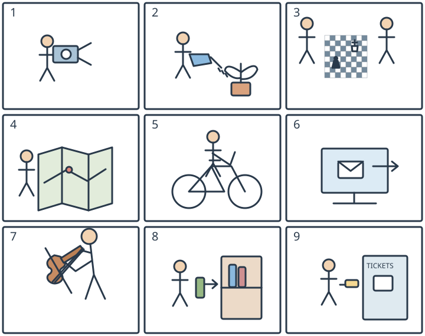

# 小六：九个动作图文配对

## 学生题面

看九幅图，从共享短语A—I中为每幅图选择合适的一项，填入字母。

共享短语：
A. read a map
B. play the violin
C. buy a ticket
D. water the plants
E. send an email
F. put books on a shelf
G. take a photograph
H. ride a bicycle
I. play chess

<!-- responses:start -->

1. 第1幅图
   A. read a map
   B. play the violin
   C. buy a ticket
   D. water the plants
   E. send an email
   F. put books on a shelf
   G. take a photograph
   H. ride a bicycle
   I. play chess

2. 第2幅图
   A. read a map
   B. play the violin
   C. buy a ticket
   D. water the plants
   E. send an email
   F. put books on a shelf
   G. take a photograph
   H. ride a bicycle
   I. play chess

3. 第3幅图
   A. read a map
   B. play the violin
   C. buy a ticket
   D. water the plants
   E. send an email
   F. put books on a shelf
   G. take a photograph
   H. ride a bicycle
   I. play chess

4. 第4幅图
   A. read a map
   B. play the violin
   C. buy a ticket
   D. water the plants
   E. send an email
   F. put books on a shelf
   G. take a photograph
   H. ride a bicycle
   I. play chess

5. 第5幅图
   A. read a map
   B. play the violin
   C. buy a ticket
   D. water the plants
   E. send an email
   F. put books on a shelf
   G. take a photograph
   H. ride a bicycle
   I. play chess

6. 第6幅图
   A. read a map
   B. play the violin
   C. buy a ticket
   D. water the plants
   E. send an email
   F. put books on a shelf
   G. take a photograph
   H. ride a bicycle
   I. play chess

7. 第7幅图
   A. read a map
   B. play the violin
   C. buy a ticket
   D. water the plants
   E. send an email
   F. put books on a shelf
   G. take a photograph
   H. ride a bicycle
   I. play chess

8. 第8幅图
   A. read a map
   B. play the violin
   C. buy a ticket
   D. water the plants
   E. send an email
   F. put books on a shelf
   G. take a photograph
   H. ride a bicycle
   I. play chess

9. 第9幅图
   A. read a map
   B. play the violin
   C. buy a ticket
   D. water the plants
   E. send an email
   F. put books on a shelf
   G. take a photograph
   H. ride a bicycle
   I. play chess

<!-- responses:end -->

## 作者核对

### 1：G

选G：人物双手持有镜头的相机并朝外取景；不是地图/电脑/票机等其他八活动。 候选其余各项所需活动线索均不在该图中。

### 2：D

选D：壶嘴水滴落向盆栽；不是拍照、棋、地图、骑车、邮件、乐器、放书或买票。 候选其余各项所需活动线索均不在该图中。

### 3：I

选I：两人对坐棋盘且有棋子；无其他活动必要对象。 候选其余各项所需活动线索均不在该图中。

### 4：A

选A：人物身旁展开有路线折痕的地图；不是纸票（无TICKETS柜）或电子邮件屏幕，其余候选也无对应器具。 候选其余各项所需活动线索均不在该图中。

### 5：H

选H：车架连接两轮、人物跨车运动；无其他候选的活动对象。 候选其余各项所需活动线索均不在该图中。

### 6：E

选E：电脑屏幕信封及向外箭头对应发送邮件；不是地图或纸质图书，也无其余六活动器具。 候选其余各项所需活动线索均不在该图中。

### 7：B

选B：人物颈肩侧持弦乐器并有琴弓；非棋盘/电脑等，九项中只有violin吻合。 候选其余各项所需活动线索均不在该图中。

### 8：F

选F：人物持书，右向箭头指到带书架层，放书；不是读地图、买票或电脑邮件，其余活动无相应对象。 候选其余各项所需活动线索均不在该图中。

### 9：C

选C：人物在TICKETS窗口拿小纸票；不是地图/摄影/上架/邮件，也无骑车棋盆栽乐器。 候选其余各项所需活动线索均不在该图中。

原创虚构材料；参照已核完整源模式，不沿用源正文或把原键当gold。所有候选逐空独立检查，不依赖排除已用项。作者自审不等独立教研、学生、商用或生产验证。
