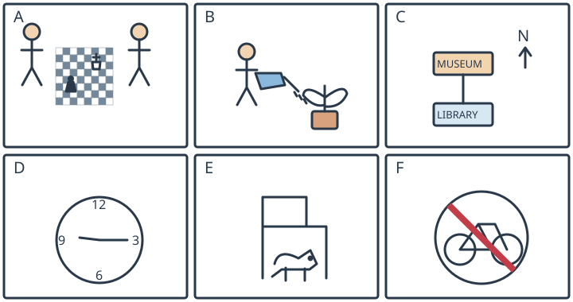

# 小六：六句与共享情境图

## 学生题面

看全部六幅情境图，为每个句子选择相符的图A—F。

<!-- responses:start -->

1. This sign tells people not to ride a bicycle here.
   A. 图A
   B. 图B
   C. 图C
   D. 图D
   E. 图E
   F. 图F

2. The museum is north of the library.
   A. 图A
   B. 图B
   C. 图C
   D. 图D
   E. 图E
   F. 图F

3. The dog is under the chair.
   A. 图A
   B. 图B
   C. 图C
   D. 图D
   E. 图E
   F. 图F

4. The clock shows a quarter past nine.
   A. 图A
   B. 图B
   C. 图C
   D. 图D
   E. 图E
   F. 图F

5. Two people are playing chess.
   A. 图A
   B. 图B
   C. 图C
   D. 图D
   E. 图E
   F. 图F

6. A person is watering a plant.
   A. 图A
   B. 图B
   C. 图C
   D. 图D
   E. 图E
   F. 图F

<!-- responses:end -->

## 作者核对

### 1：F

F自行车图加红斜杠是禁止骑车；A棋、B浇水、C地图、D时钟、E狗不是禁行符号。

### 2：C

C带N向上箭头，museum在library上方，故北；A/B动作、D时钟、E狗、F禁骑不含此方位。

### 3：E

E狗位于座面下、椅腿间；A棋、B植物、C楼图、D时钟、F标志均不含狗与椅关系。

### 4：D

D分针指3、时针刚过9，对应9:15；A/B活动、C地图、E宠物、F禁行无钟点。

### 5：A

A棋盘棋子且两人对坐；B浇植物不是棋，C/D/E/F分别地图钟狗标志。

### 6：B

B水壶水滴向盆栽；A为对弈，C地图、D钟、E椅下狗、F禁止骑行。

原创虚构材料；参照已核完整源模式，不沿用源正文或把原键当gold。所有候选逐空独立检查，不依赖排除已用项。作者自审不等独立教研、学生、商用或生产验证。
