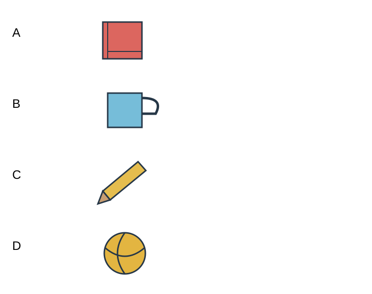

# 图词配对：primary1-four-picture-matches

## 学生题面

看四张图片，为每个单词选择对应图片的字母。

<!-- responses:start -->

1. cup
   A. 图A
   B. 图B
   C. 图C
   D. 图D

2. ball
   A. 图A
   B. 图B
   C. 图C
   D. 图D

3. book
   A. 图A
   B. 图B
   C. 图C
   D. 图D

4. pencil
   A. 图A
   B. 图B
   C. 图C
   D. 图D

<!-- responses:end -->

## 作者核对

### 1：B

杯子是B；A书、C铅笔、D球均不是cup。

### 2：D

球是D；A书、B杯子、C铅笔均不是ball。

### 3：A

书是A；B杯子、C铅笔、D球均不是book。

### 4：C

铅笔是C；A书、B杯子、D球均不是pencil。

完整组全部响应均保留；作者逐项核对，不等独立教研、学生难度/用时、商用权利或生产判分认证。源结构与原键质量分开，未核来源身份不补齐。
