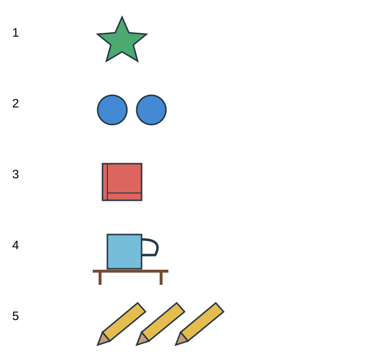

# 看图选句：primary2-five-picture-sentences

## 学生题面

看每幅图，从同号的三个句子中选出符合图片的一句。

<!-- responses:start -->

1. 第1图
   A. It is a green star.
   B. It is a red star.
   C. It is a green ball.

2. 第2图
   A. I can see one blue ball.
   B. I can see two blue balls.
   C. I can see two red balls.

3. 第3图
   A. This is a yellow pencil.
   B. This is a blue cup.
   C. This is a red book.

4. 第4图
   A. The cup is under the table.
   B. The cup is on the table.
   C. The book is on the table.

5. 第5图
   A. There are three yellow pencils.
   B. There are two yellow pencils.
   C. There are three red pencils.

<!-- responses:end -->

## 作者核对

### 1：A

图形是绿色五角星，A同时符合颜色与形状；B颜色错，C物体错。

### 2：B

图有两个蓝球；A数量错、C颜色错。

### 3：C

图为红书；A物体及颜色错，B也非图示。

### 4：B

杯底在桌面上，B正确；A位置相反，C把杯子说成书。

### 5：A

三支黄铅笔；B数量错，C颜色错。

完整组全部响应均保留；作者逐项核对，不等独立教研、学生难度/用时、商用权利或生产判分认证。源结构与原键质量分开，未核来源身份不补齐。
