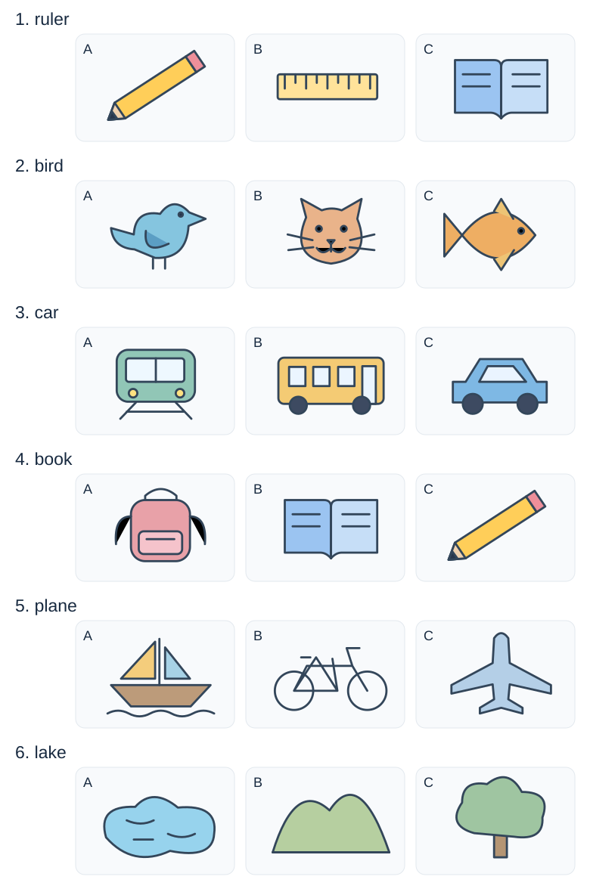

# 小二：六词三图选择

## 学生题面

看单词，选择对应的图片。每题三个图片选项，图片在下图同号行内。

<!-- responses:start -->

1. ruler（第1行）
   A. 图A
   B. 图B
   C. 图C

2. bird（第2行）
   A. 图A
   B. 图B
   C. 图C

3. car（第3行）
   A. 图A
   B. 图B
   C. 图C

4. book（第4行）
   A. 图A
   B. 图B
   C. 图C

5. plane（第5行）
   A. 图A
   B. 图B
   C. 图C

6. lake（第6行）
   A. 图A
   B. 图B
   C. 图C

<!-- responses:end -->

## 作者核对

### 1：B

第1行：A是pencil；B是ruler；C是book。仅B与ruler对应。

### 2：A

第2行：A是bird；B是cat；C是fish。仅A与bird对应。

### 3：C

第3行：A是train；B是bus；C是car。仅C与car对应。

### 4：B

第4行：A是schoolbag；B是book；C是pencil。仅B与book对应。

### 5：C

第5行：A是boat；B是bike；C是plane。仅C与plane对应。

### 6：A

第6行：A是lake；B是hill；C是tree。仅A与lake对应。

本稿保持所核来源的完整具体形式，未复制人物/节日歧义图片；未据无键来源主张独立金标。仅作者核读，未独立教研、学生试做、商用或生产验证。
