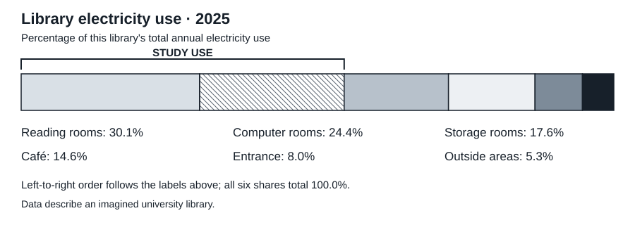

# 高三图文阅读：An Electricity Plan for the Library

依[高三扩展草案0.3](../Specifications/grade12-v0.3.md)，匹配g12.national2025.readingA完整图＋五卡＋结语/三题四选。全部校园、人物、数值、方案为原创虚构；原排放图、技术事实或原文未复制。数字图为必需输入，等价文字描述提供相同信息，不另算独立材料。

## 学生区

阅读材料及图表，从每题的四个选项中选出最佳答案。

### An Electricity Plan for the Library

Buying equipment described as energy-saving does not, by itself, show how much electricity a building will use. The result also depends on when rooms are occupied and which services must remain available. An imagined university library has therefore prepared a set of small trials rather than approving one replacement programme for the whole building.

The chart shows how the library used its electricity during 2025. Each percentage is a share of the building's total annual electricity use, not a share of the university's electricity bill. Reading rooms and computer rooms are grouped as “study use”. The entrance equipment will retain its existing programme; the other five areas have trial proposals below.

图表文字描述：Reading rooms 30.1%；Computer rooms 24.4%；Storage rooms 17.6%；Café 14.6%；Entrance 8.0%；Outside areas 5.3%。前两项归为Study use；分母为本图书馆2025全年用电量。

#### Reading rooms · Adjustable lamps

New lamps would let readers adjust the light at individual desks. The trial requires replacing existing lamps and checking the desks before installation. Readers would still be able to use the rooms in the evening.

#### Computer rooms · A shutdown schedule

The proposal requires installing new control software. Some computers run overnight research tasks, so the library must first agree with researchers which machines can be switched off and when.

#### Storage rooms · Existing timers

The lights already have working timers. Staff have confirmed when these rooms are empty. They can test a revised timetable using the current controls, without replacing equipment or installing new controls.

#### Café · Different refrigerators

The café would need new refrigerators. Before choosing them, staff must compare their capacity with the amount of food stored. A smaller machine is unsuitable if it cannot hold the food needed for a busy day.

#### Outside areas · Movement sensors

New sensors would reduce lighting when no one is passing. Installation and a night-time inspection are required before the trial can begin, because access to the building must remain clearly visible.

Project coordinator Dana Lee wants four weeks of meter readings for each trial, alongside records of how people use the spaces. “A fall in electricity use is not enough if the service becomes worse,” she says. “Publish both sets of results before deciding which proposals should be extended. We need evidence about this library, rather than a promise printed on a box.”

1. What share of the library's annual electricity use was “study use” in 2025?

   A. 24.4%.
   B. 30.1%.
   C. 54.5%.
   D. 72.1%.

2. Which trial can begin without replacing equipment or installing new controls?

   A. The reading-room trial.
   B. The computer-room trial.
   C. The storage-room trial.
   D. The outside-area trial.

3. What does Dana Lee recommend?

   A. Choose equipment by the promises on its packaging.
   B. Judge each trial using both electricity and service evidence.
   C. Replace the equipment in every area at the same time.
   D. Accept worse service whenever electricity use falls.

## 作者区

作者参考C/C/B，每题1分为原创工程选择，不当源每题2.5分。所有三题依完整图、方案与结语，图例和年度分母不能省略。

| 题 | 支持依据 | 三项排除 |
| --- | --- | --- |
| 1 C | Study use明确是Reading rooms与Computer rooms；30.1＋24.4＝54.5 | A仅电脑、B仅读书；D再加Storage17.6，后者不在Study use组中。不能因Storage也在图书馆而并入学习组，分母不是大学电费 |
| 2 C | Storage已有可用定时器、空置时段已核、直接改现有时刻表，明示不换设备/装新控制 | A换灯、B装新控制软件、D装新传感器并检查；是否晚间开放不是本题判别条件，C不是凭设备更少推测 |
| 3 B | Lee要求电表记录与空间使用/服务记录两套证据，再决定扩展 | A正是她反对的包装承诺；C与先小试再决策相反；D忽略服务变差条件。她未声称四周足以完成统计标定 |

全组解答C/C/B。第1题若图与文字描述都缺失则不能作答；第2题只看题干“新控制”不能跳过全部方案；第3题必须保留服务条件。图百分比合100.0，Study use54.5，72.1是两学习区＋存储区的错误分组，不是另一套分母。

源第1题为交通类别聚合，本題为明确学习区域聚合；新第2题改为明确准备条件，避免仅靠“比较容易”的无尺度排序。读者可选普通灯/软件主题的输入，但这不是实际校园能源建议或观测。图视觉与作者核查另存；当前稿实际保存修订次数0，作者理由不等独立或学生证据。
