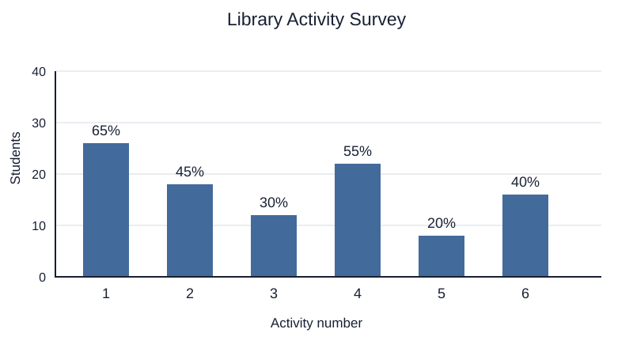

# 初二三选图文阅读：A Library Activity Survey

来源模式：g8.changjun2024.readingA；按[初二扩展草案0.3](../Specifications/grade8-v0.3.md)写完整图文三题三选。虚构活动调查，保留编号类别、人数轴、百分标签和多选分母；类别从11改6、人数从50改40，题目自己的改变不冒充原卷要求。

## 学生区

阅读说明、活动列表和图表，选择每题的最佳答案。图中的百分比都以参与调查的40名同学为分母。

The school library asked 40 Grade Eight students which activities they wanted next month. Each student could choose several different activities from the list. A student could choose each activity only once. The chart shows the results. The numbers under the bars match the activity numbers below. The height of each bar shows the number of students who chose that activity. The label above it shows the percentage of the 40 students who made that choice.

1. Listening to stories
2. Drawing book covers
3. Making project kits
4. Sharing book reviews
5. Writing poems
6. Acting out short scenes

图表文字替代：标题为Library Activity Survey，纵轴为Students，范围0—40，每10人一格；横轴为Activity number，1—6依次对应上方列表。柱顶标签依次为65%、45%、30%、55%、20%、40%。每项百分比的分母都是40名同学；同一人可以选择不同活动。文字替代与图是同一份输入。

1. Which activity did the largest number of students choose?
   A. Drawing book covers.
   B. Sharing book reviews.
   C. Listening to stories.
2. How many students chose making project kits?
   A. 8.
   B. 12.
   C. 30.
3. Which statement is supported by the survey?
   A. The total number of activity choices was greater than the number of students.
   B. Every student chose exactly the same number of activities.
   C. No student chose both stories and book reviews.

## 作者区

作者参考：1 C，2 B，3 A；各1分是本原创选择。全组虚构，仅参照源任务结构，不复用原担忧类别或原百分数，不证明真实学生偏好。

| 题 | 答案依据 | 其余选项与误读路径 |
| --- | --- | --- |
| 1 C | 六类分母相同，65%是最大，编号1为Listening to stories，26人 | A为45%/18人；B为55%/22人，虽为第二多也小于65%；不把题目B字母当横轴编号 |
| 2 B | 第3类30%×40=12人，题干问人数 | A8是第5类20%的计数；C30把百分标签数当人数 |
| 3 A | 六类计数26/18/12/22/8/16，共102类选择，大于40名参与者 | B没有个体记录，而且102不能等于40×整数相同选择数；C故事26＋书评22超过40，同40人总体内至少8人重叠，绝非无人共选 |

百分和255%表示多选边际总和，不归一100%。102是类选择次数，仍只有40名参与者。第3题C可用集合下界排除，但不能推断恰8人、具体姓名或所有其它交集；题目所需只是A与B/C比较。可以构造满足计数的个体选择矩阵，非真实作答记录或学生标定。

本组三题每题三选，共9项逐项审核。SVG可见标签/desc与文字替代只给原值，没有预先合计102或第2题12人。正文/列表、题干、选项、图中标签分开量度；重复文字替代不当另一篇文章。

实际保存修订次数0，本聊天AI全组解答；未有独立教师、学生、手机呈现或商用准入。头像可在答题要求旁，无角色开场故事。图文审核只支持当前版本，未单独运行生产出题模型。
