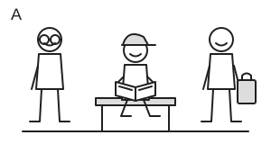
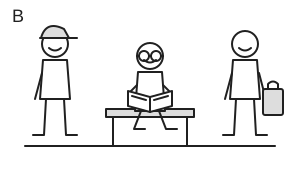
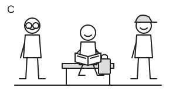
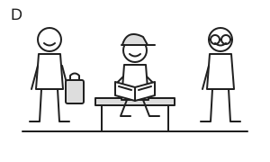

# 初一原创图文联合阅读：阅读角帮手

虚构学校及角色，参照[初一规格0.2](../Specifications/grade7-v0.2.md)和g7.2019.readingB的3题四选、细节/指代/图文空间关系。全部四图为自写SVG线描，未复制源画；原题文字称photo但实际选项是线描，本题直接称drawing。来源缺动词不沿用，三个虚构人物相较源四人是明确的较简空间变体，不代表初一年级已标定。

阅读短文，从每题所给的四个选项中选出最佳答案。第3题须同时阅读最后一段和全部四幅图；左右以你看图时的方向为准。

<!-- passage:start -->
Our school has a small reading corner next to the music room. There are two low shelves and a long bench. Students can borrow books there on Monday and Wednesday afternoons. On Friday, they can read there, but they cannot take books home.

We put pictures of book covers and short names on the shelves. **They** help new students find the books they want. Two older students are there to answer questions. We ask everyone to speak quietly because some children like reading on the bench.

Here is a drawing of three helpers on our Book Day. Mr Hale wears round glasses and stands on the left. Ms Drew wears a cap and sits on the bench in the middle, holding an open book. I stand on the right with a small bag. You can see all three of us in the drawing.
<!-- passage:end -->

1. How many afternoons each week can students borrow books from the reading corner?

   A. One.
   B. Two.
   C. Three.
   D. Four.

2. What does the word “They” in Paragraph 2 refer to?

   A. The music room and the reading corner.
   B. The older students who answer questions.
   C. The children who read on the bench.
   D. The pictures of book covers and short names.

3. Which drawing matches the last paragraph?

   A.

   

   B.

   

   C.

   

   D.

   

## 作者答案、图片关系与替代检查

| 题 | 答案 | 依据及其余选项排除 |
| --- | --- | --- |
| 1 | B | 可借书仅Monday/Wednesday两个下午；Friday只在场阅读，A漏一天、C把Friday当借书、D增加未给一天。 |
| 2 | D | 段首covers/short names后的They指这两类索引信息；A将两个地点当成索引信息、且本段未把音乐室用于找书，B/C人物在后句才进入，不是该句的前置先行对象。 |
| 3 | A | 左glasses站立、中cap坐凳持书、右bag站立三条件全部吻合；B把前两人标记交换，C把cap与bag交换且cap不坐中间，D把glasses/bag左右互换。不能只见cap/book就选D。 |

完整四图回读、位置/标记矩阵和段落关系检查；图片顺序为A—D，不能只展示正确图或在加载失败时留下三个选项。图片替代描述逐图保存相同可见信息，帮助无障碍阅读，不写“正确答案”；它同样是联合输入，不能当装饰描述删去。左右明确为读者方向，避免人体左手/画面左侧混淆。

图中三人没有真实年龄/性别/身份，身份只能由本文条件对应，不凭身体外观推教师或学生。共同的坐凳/持书线索不能替代其他位置与标记。人物关系是虚构信息，不当社会事实或行为规则。

实际修订0；同作者图文核对，不冒充独立教师/学生，图画识别/可访问展示及用时仍需真实验证。图文资产、顺序、图片与文字摘要绑定在作者检查表；当前机器检查只证完整关联，不判图是否容易看懂。
