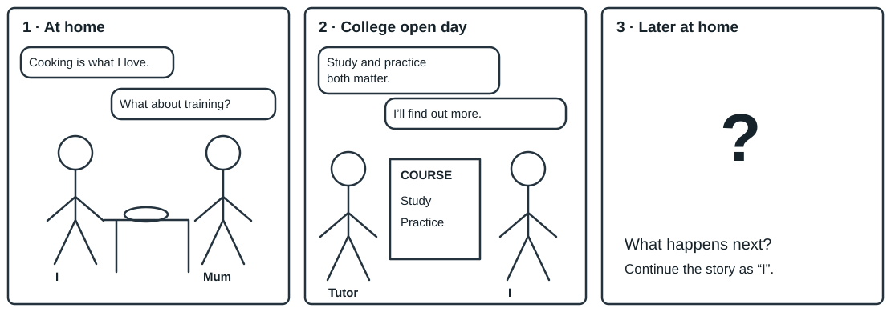

# 高一：看图续写设计原型（原图模式待核）

来源完整形式参照`grade10-shenzhenlower2026-21cnjy26167651.pictureContinuation`；原件与原创分别保留，未把源键当新题金标。

## 学生题面

观察前两幅图，根据角色和所给首句，用第一人称续写第三幅图的情节。续写约70词，给定首句不计入词数。

## Planning My Future

图中人物：I（叙述者）、Mum（妈妈）、Tutor（课程导师）。

等价图示信息：第1幅在家，我说“Cooking is what I love.”，妈妈问“What about training?”。第2幅在学院开放日，导师说“Study and practice both matter.”，课程牌上有Study/Practice；我说“I’ll find out more.”。第3幅标记Later at home，情节留空，由你用“I”续写。

词汇提示：chef 厨师；training 培训。

<!-- responses:start -->

1. 使用给定首句，猜测并写出第三幅图的完整情节
   Mum tasted the soup I had made and asked what I planned to do next.
   [在此续写本段]

<!-- responses:end -->

## 作者核对

### 逐响应作者参考

| 响应 | 作者参考 | 判断依据 |
| --- | --- | --- |
| 1 | Mum tasted the soup I had made and asked what I planned to do next. I told her about the college open day and showed her the course information. It included both classroom lessons and time in a training kitchen. I wanted to visit again and ask the tutor which skills I should practise first. Mum read the page, then offered to help me make a list of questions. I knew that enjoying cooking was only a beginning, but I now had a practical step to take. | 参考把培训信息、下一步行动与妈妈回应衔接；不要求必须成为厨师或凭一次展示立即获得职业资格。首句不计入约70词。此为作者设计图题原型，未核源原图的面板和角色。 |

### 完整形式与边界

本格是**作者设计原型，源完整图示模式待核**。已有高一源确有看图续写、猜测第三幅图、约70词和首句不计词数；但必要原图/角色未取得。这里由作者明确设计两幅已给＋第三幅留白和三人物，不能称为找回原图、源面板数已确认或经样本验证的完整模式；不升级冻结源necessary_input_complete=false。

本稿自身学生输入完整：原创SVG、等价图示、角色、给定首句、词汇和一个完整输出域均绑定。可供用户看这种图题的出题效果，仍与69个有完整模式参照的普通代表分开计量。源参考示例称117字并与70左右不一致，也未作为新稿的合格长度标准。

### 未评分参考续文

Mum tasted the soup I had made and asked what I planned to do next. I told her about the college open day and showed her the course information. It included both classroom lessons and time in a training kitchen. I wanted to visit again and ask the tutor which skills I should practise first. Mum read the page, then offered to help me make a list of questions. I knew that enjoying cooking was only a beginning, but I now had a practical step to take.

### 作者检查点与反例

续文应用第一人称，联系图2课程的学习与实践信息，说明下一步及家庭对话；结尾可有分歧，只要与人物行为和首句衔接。若只写“我立即成了著名厨师”，没有培训或行动桥梁，则不能用词汇华丽掩盖因果缺口。源总15分不能倒推出已验证的分析rubric。

作者参考只供核读，不自动评分；所列开放表达不是穷尽集合。尚未独立教研、目标学生试做、商用或生产模型验收。材料中的人物/活动/数字为原创虚构，不作真实机构或科研事实报告。
