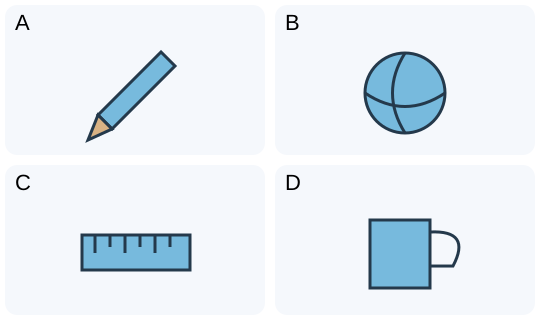

# 小一：四图词配对 · 2

## 学生题面

看四张图片，为每个单词选择对应图片字母。

<!-- responses:start -->

1. cup
   A. 图A
   B. 图B
   C. 图C
   D. 图D

2. pencil
   A. 图A
   B. 图B
   C. 图C
   D. 图D

3. ball
   A. 图A
   B. 图B
   C. 图C
   D. 图D

4. ruler
   A. 图A
   B. 图B
   C. 图C
   D. 图D

<!-- responses:end -->

## 作者核对

### 1：D

图D为cup；其余图依次为pencil, ball, ruler，均非此物。

### 2：A

图A为pencil；其余图依次为ball, ruler, cup，均非此物。

### 3：B

图B为ball；其余图依次为pencil, ruler, cup，均非此物。

### 4：C

图C为ruler；其余图依次为pencil, ball, cup，均非此物。

完整材料与每个响应均由作者回填复核；所有情境为虚构。图/词义复用不当独立暴露家族。源键不当gold，作者自审不等独立教研、学生、商用或生产验收。
