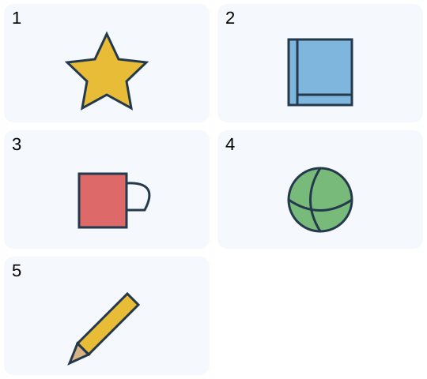

# 小二：五图选句 · 1

## 学生题面

看每幅图，从同号的三个句子中选出符合图片的一句。

<!-- responses:start -->

1. 第1图
   A. It is a blue star.
   B. It is a yellow star.
   C. It is a yellow ball.

2. 第2图
   A. This is a blue book.
   B. This is a red book.
   C. This is a blue cup.

3. 第3图
   A. It is a red pencil.
   B. It is a green cup.
   C. It is a red cup.

4. 第4图
   A. I can see a green star.
   B. I can see a green ball.
   C. I can see a yellow ball.

5. 第5图
   A. This is a yellow pencil.
   B. This is a blue pencil.
   C. This is a yellow book.

<!-- responses:end -->

## 作者核对

### 1：B

图示star，颜色#e9bc38。B同时符合；另两项分别错在颜色或物品，详见逐项句面。

### 2：A

图示book，颜色#7eb6dd。A同时符合；另两项分别错在颜色或物品，详见逐项句面。

### 3：C

图示cup，颜色#dd6969。C同时符合；另两项分别错在颜色或物品，详见逐项句面。

### 4：B

图示ball，颜色#77ba7a。B同时符合；另两项分别错在颜色或物品，详见逐项句面。

### 5：A

图示pencil，颜色#e9bc38。A同时符合；另两项分别错在颜色或物品，详见逐项句面。

完整材料与每个响应均由作者回填复核；所有情境为虚构。图/词义复用不当独立暴露家族。源键不当gold，作者自审不等独立教研、学生、商用或生产验收。
