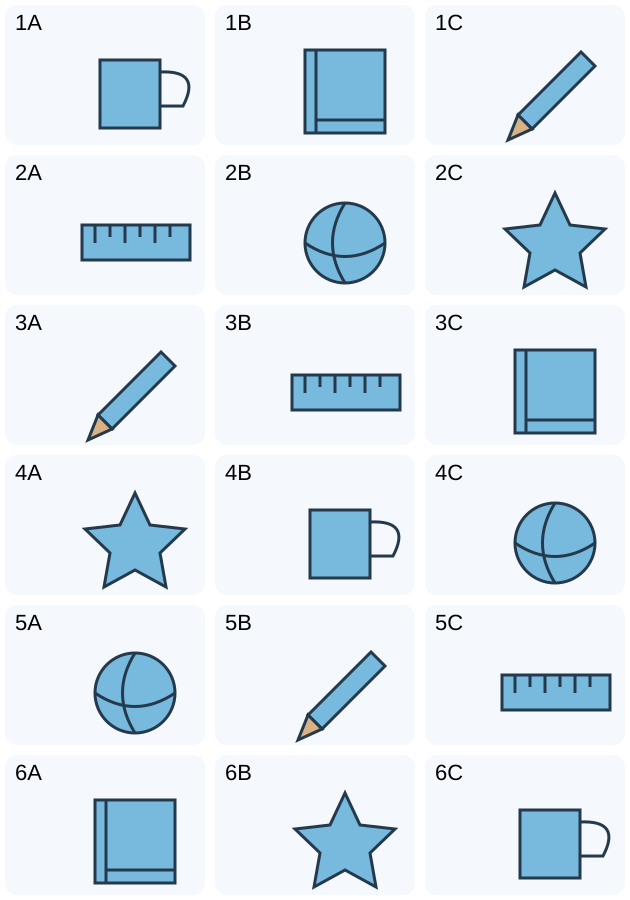

# 小二：六词三图 · 1

## 学生题面

看单词，从同号行的三个图片中选择对应图片字母。

<!-- responses:start -->

1. pencil（第1行）
   A. 图A
   B. 图B
   C. 图C

2. ruler（第2行）
   A. 图A
   B. 图B
   C. 图C

3. book（第3行）
   A. 图A
   B. 图B
   C. 图C

4. cup（第4行）
   A. 图A
   B. 图B
   C. 图C

5. ball（第5行）
   A. 图A
   B. 图B
   C. 图C

6. star（第6行）
   A. 图A
   B. 图B
   C. 图C

<!-- responses:end -->

## 作者核对

### 1：C

第1行：A=cup, B=book, C=pencil；只有C符合pencil。

### 2：A

第2行：A=ruler, B=ball, C=star；只有A符合ruler。

### 3：C

第3行：A=pencil, B=ruler, C=book；只有C符合book。

### 4：B

第4行：A=star, B=cup, C=ball；只有B符合cup。

### 5：A

第5行：A=ball, B=pencil, C=ruler；只有A符合ball。

### 6：B

第6行：A=book, B=star, C=cup；只有B符合star。

完整材料与每个响应均由作者回填复核；所有情境为虚构。图/词义复用不当独立暴露家族。源键不当gold，作者自审不等独立教研、学生、商用或生产验收。
