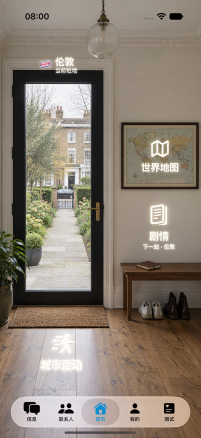
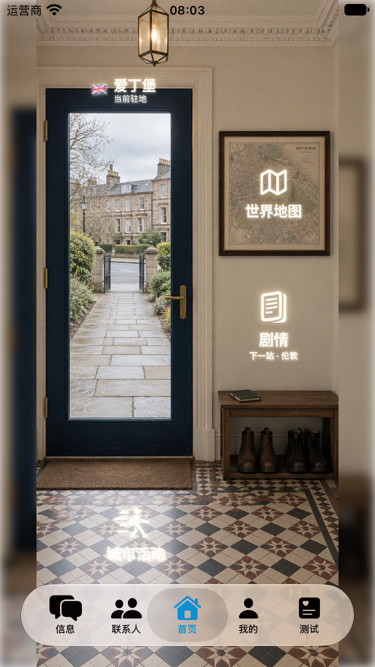

# 首页背景独立重制与验收：2026-09-10

本轮在 **c955** 完成15城背景替换与原生入口重新标定。15张旧图（含存疑图）全部退回；本轮25次独立文生图中10张失败稿删除，最终15张逐张通过原图和应用复查。没有图生图、局部生成修补或用UI遮盖结构问题。

## 删除与包体

- 旧随包JPEG共7,503,916字节已被替换；旧复查图片副本3张删除；另外清理了30份可定位的历史生成原图。只保留哈希、提示词、退回原因和Git历史，不在应用里存失败图片。
- 当前首页目录每城只留一张JPEG，共 **9,033,340字节（8.62MiB）**。新图总量比旧图增加1,529,424字节，不能把“删除旧图”说成应用净减小7.16MiB。
- 原生尺寸中心裁切至853:1844比例，JPEG95/无色度抽样压缩；不放大。最终宽829–853px，是402pt设计画布至少2倍。原始生成路径、尺寸、裁切、哈希见 [候选与最终记录](../Assets/HomeScenes/Replacement-2026-09-10/candidates.json)。
- 提示词、参考及验收截图均在 `Assets/HomeScenes` 文档目录，项目资源来自 `App`，这些验收资料不随包。运行图仅为 `App/Assets.xcassets/home_city_*.imageset/home_city_*.jpg`。

## 实际检查

使用本轮完整实景照片作为结构参考；逐城记录实际观察和设计推断，未把参考照片传给生成器或装进软件。先看完整场所，再写玄关位置/地面/门扇/家具使用路线；生成后先看整图，再按上左、上右、中左、中右、下部查看原生局部，随后核对最终裁切图、投影叠线和模拟器截图。

检查重点是**自身门槛到院落/人行路线**，不是只看对街房子。门玻璃露出近侧落脚地面；廊柱在侧边，院门或通道有可理解的出口。都柏林保留有实景依据的临街台阶，其他城市按具体庭院/门廊类型制作，并非统一给城市生造前院。

完整实际参考、照片URL和观察事实见 [references.json](../Assets/HomeScenes/Replacement-2026-09-10/references.json)。参考不是测绘：相机眼高、室内反向机位和具体尺寸明确作为设计假设，不声称复刻博物馆或准确城市街景。

## 用户问题逐项复验

旧版拒收不撤销；以下关闭的是**新版本**对应问题。每项均有新原图、五区复查和两种屏幕实际截图，不以生成/测试成功代替肉眼审查。

| 问题 | 城市/新版本 | 可观察修正 | 本版验收 |
| --- | --- | --- | --- |
| H-01 | 伦敦 v3 | Own broad paving -> long level path between planted borders -> hinged iron gate -> public pavement/road -> far houses. No raised garden or hidden near-side platform. | [通过](../Assets/HomeScenes/Replacement-2026-09-10/london-v3-acceptance.md) |
| H-02 | 开普敦 v1 | Near brick paving -> unobstructed central courtyard aisle -> visible open arch and gate; no road or opaque panel hiding own floor. | [通过](../Assets/HomeScenes/Replacement-2026-09-10/capetown-v1-acceptance.md) |
| H-03 | 墨尔本 v1 | Modest residential adaptation, indoor reverse view and 1.5m camera are design assumptions, not reconstructed museum. Left glazed door -> own veranda -> descending shallow stair -> garden path. Map on broad right wall and bench below, clear swing. | [通过](../Assets/HomeScenes/Replacement-2026-09-10/melbourne-v1-acceptance.md) |
| H-04 | 奥克兰 v3 | Own timber veranda landing -> central descent -> planted garden path -> distinct gate. Closed glass instead of earlier open-door design; no central post. | [通过](../Assets/HomeScenes/Replacement-2026-09-10/auckland-v3-acceptance.md) |
| H-05 | 纽约 v1 | Own timber porch -> central descending steps -> garden approach -> near pavement and road. Local Brooklyn house type replaces old brownstone premise. | [通过](../Assets/HomeScenes/Replacement-2026-09-10/newyork-v1-acceptance.md) |
| H-06 | 新加坡 v1 | Near threshold -> continuous private tiled court -> visible boundary gate -> public street; no road at threshold. | [通过](../Assets/HomeScenes/Replacement-2026-09-10/singapore-v1-acceptance.md) |
| H-07 | 都柏林 v1 | Own landing -> descending treads bounded by side rails -> broad near pavement -> curb/road -> opposite houses. | [通过](../Assets/HomeScenes/Replacement-2026-09-10/dublin-v1-acceptance.md) |
| H-08 | 爱丁堡 v2 | v2 simplifies to level private paved forecourt -> open gate -> pavement/road. Camera/reverse view and continuous level path are design decisions, not measured reconstruction. v1 incorrect upward stairs deleted. | [通过](../Assets/HomeScenes/Replacement-2026-09-10/edinburgh-v2-acceptance.md) |
| H-09 | 温哥华 v1 | Own veranda landing -> central descending stairs between side rails -> brick garden path -> street setback. | [通过](../Assets/HomeScenes/Replacement-2026-09-10/vancouver-v1-acceptance.md) |
| H-10 | 内罗毕 v3 | Level own veranda stone paving -> continuous stone garden walk to gate, planting to sides. No invented rising garden. | [通过](../Assets/HomeScenes/Replacement-2026-09-10/nairobi-v3-acceptance.md) |
| H-11 | 多伦多 v2 | Simplified level stone landing/path -> open gate -> distant street/gabled brick houses. Remove uncertain elevated garden in v1; not a replica of Spadina. | [通过](../Assets/HomeScenes/Replacement-2026-09-10/toronto-v2-acceptance.md) |
| H-12 | 悉尼 v1 | Modest garden residence inspired by veranda construction, not museum reconstruction. Standing inside reverse view; near-level veranda connects to garden walk. Indoor map and shoe bench to right clear of circulation. | [通过](../Assets/HomeScenes/Replacement-2026-09-10/sydney-v1-acceptance.md) |
| H-13 | 新奥尔良 v2 | Indoor reverse view of a courtyard guesthouse, not museum replica. Eye height 1.5m assumed. Glazed door opens to near paved landing and clear garden walk toward passage. Ordinary wall map and shoe bench clear of route. | [通过](../Assets/HomeScenes/Replacement-2026-09-10/neworleans-v2-acceptance.md) |
| H-14 | 曼彻斯特 v2 | Level threshold paving -> planted front walk -> open paved forecourt, beyond which houses have separate garden setback; no wall closing path. | [通过](../Assets/HomeScenes/Replacement-2026-09-10/manchester-v2-acceptance.md) |
| H-15 | 金斯敦 v1 | Modest guesthouse interpretation not replica; inside reverse view and dimensions assumed. Door -> own veranda landing -> central descending steps -> garden path. Map/bench to right outside door swing. | [通过](../Assets/HomeScenes/Replacement-2026-09-10/kingston-v1-acceptance.md) |

## 原生入口

保留 `HomeDepartureMetalView`、`HomePerspectiveArtwork`、`DSHologramMaterial` 和现有导航/按压流程。重新标定全部60组城市名称、地图、剧情、活动的位置与平面；地图和同墙剧情共用按照片边缘测量的单应矩阵，热区与图文使用同一来源。新加坡剧情移到地图上方，避开墙面瓷砖装饰带；没有缩小字体把它硬塞进狭窄区域。

实际截图检查发现爱丁堡活动入口严重压扁，即使点击测试通过也退回了该UI版。修正地面标定，增加纵向投影至少原高度70%的防退化断言，标准/小屏重新截图、点击通过。旧UI失败附件只作为XCTest历史，不进入最终截图索引。

## 验证证据

| 证据 | 结果 | 范围 |
| --- | --- | --- |
| `build/HomeReplacementUI27.xcresult` | 15/15 | iOS27，iPhone17Pro，402×874pt；每城地图/剧情/活动实际点击并返回 |
| `build/HomeReplacementUICompact27.xcresult` | 15/15 | iOS27，SE3模拟设备配置，375×667pt；同样逐城三入口 |
| `build/HomeReplacementUIFix27.xcresult` | 2/2 | 爱丁堡UI修正；伦敦三入口左边内侧8pt按压及后台恢复 |
| `build/HomeReplacementUICompactFix27.xcresult` | 2/2 | 小屏相同修正、边缘按压及后台恢复 |
| `build/HomeReplacementFinalGeometryClean27.xcresult` | 9/9 | 15资源解码、像素标定回归、四种视口边界、投影内可容纳44×44pt方形、字形纵向比例等 |
| `build/HomePerspectiveAudit` | 15城 | 编译生产几何生成叠线；哈希/尺寸/边缘一致并逐张查看 |

共34项UI测试、9项聚焦单测通过。四种几何视口为375×667、393×852、402×874、440×956；不是四种实机测试。

标准模拟器：`3EBB1CAE-D66F-4CF5-AC18-C1C07F4DB7FB`，iOS27.0/24A5423a。小屏：`C74C8559-D212-4430-B007-3B32715C013E`，本轮创建的c955专用iOS27模拟设备。没有清空应用数据库。

最终单测初次在UI/单测scheme切换后出现 `StoryEngine.EpisodeSession` 链接错误；清理本工作树构建产物后重跑9/9通过。早期越界失败和该链接失败保留结果记录，不冒称通过；明细见 [verification.json](../Assets/HomeScenes/Replacement-2026-09-10/verification.json)。

手机实机未测；系统“减少动态”设置未专项重跑。本轮背景是静态图片，无视频、人物步态、循环或视频失败降级，不把这些不适用项写成播放验证通过。没有调用在线AI对话评估或部署。

## 最终截图

这是应用实际截图缩至屏幕点尺寸，不是UI合成示意。30张原始附件的路径、设备、哈希和缩放方式见 [截图索引](../Assets/HomeScenes/Replacement-2026-09-10/ui/evidence.json)。每城两尺寸图也位于该城验收记录。

## 放行

15城当前可见结构与入口范围验收通过，阻断0、待修0、待证实0；没有保留退回或存疑母版。最终资产和坐标已接入，当前工作树可直接构建运行。单张生成图不能证明不可见的完整建筑，也不承诺永远发现不了新问题；后续用户指出具体缺陷时应按同一规则撤销该版并复验。
