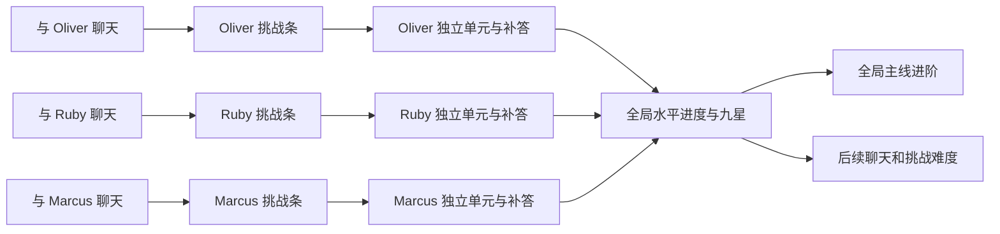

# 角色单元挑战与全局英语旅程：实施总纲

日期：2026-09-26。状态：实施中，底座、旧系统退出和可信聊天计数已实现并上线；题库、完整界面和全局进阶继续开发。本文取代旧对话学习系统的产品实施方向。

全局水平进阶的事务、剧情续读、档案同步与原生确认流程见[进阶实施记录](promotion-2026-09-26.md)。正式课程验收清单尚未发布，不能将工程流程验收等同于完整学年已开放。

内容扩展已新增三个主角色的四年级 9 个原创单元；实际教材版本、核读页码、逐题质量边界及验证见[四年级内容记录](primary4-content-2026-09-26.md)。这批与三年级合计 18 个单元，完整样板与课程仍在建设。

规划已提交，当前按本文阶段推进开发。各阶段实际证据见[工程进度账本](status.md)；底座或文档提交均不代表学习系统已经完成。

## 1. 已确认的需求与边界

1. 用户与角色双方的聊天字符累积该角色挑战条，暂定 1000 字符开启一次挑战。
2. 挑战由原创情景剧情与数个独立题目组成。剧情营造情境，任何题目脱离剧情仍能回答，不做剧情阅读理解。
3. 同一角色反复积累、反复挑战，每次抽取不同单元；各角色的积累、活动挑战、内容与记录独立。
4. 答对题数决定全局水平进度；错题可从历史记录补答，获取尚未获得的进度。
5. 全局水平需长期积累；等级内设置九颗星作为里程碑。达标与主线进阶联动，影响之后的聊天和挑战。
6. 重做“英语旅程”；复用当前水平档位、自评和测评逻辑；保留手动选择，并在变更前强提醒。
7. 聊天页向左滑动进入该角色学习页，展示全部角色学习信息，并有与角色相符的装饰。
8. 按中国多版本小学至高中英语教材建立内容依据；预设内容由本任务的编写者逐单元原创、逐题复核，不能靠替换角色名批量充数。
9. 某角色某水平预设用尽后，服务端按详细规范生成新内容，经质量检查后入公共题库，供其他用户使用。
10. 开发阶段允许少量主角色、少量水平验证，但完整产品目标不能缩成样板题库。
11. 用户于本轮明确：旧学习历史数据可以完整删除，相关客户端未发布，不需要旧学习版本兼容或数据迁移适配。
12. 架构质量、内容质量、界面与交互质量同等重要；不能用其中一项通过代替其他项。

删除授权只覆盖旧学习系统，包括被否定原型。保留聊天、角色、关系、收藏、用户档案和非学习专属的剧情记录；不清空数据库或混删共享数据。

## 2. 产品由三个空间组成

| 空间 | 职责 | 主要内容 |
| --- | --- | --- |
| 聊天 | 自然交流、积累挑战机会 | 原聊天体验；轻量学习入口和达标提示，不插题打断聊天 |
| 角色学习页 | 管理与这个角色的练习 | 1000 字符条、当前挑战、学习主题、待补答记录、已完成单元 |
| 英语旅程 | 查看全局成长和主线 | 当前水平、九星进程、距下一目标、各角色贡献、主线章节、水平调整 |

挑战使用独立的全屏演绎与答题界面，不复用聊天气泡作为题目列表。设计细节见[界面与交互方案](unit-learning-experience-2026-09-26.md)。

## 3. 建议采用的规则

以下是将需求补全为可实现行为的默认设计，具体数值仍需样板验证；不是用户已经指定的全部细节。

### 3.1 聊天计数与挑战循环

- 计算成功持久化的用户正文和角色最终回复正文；语音按最终转写计数。使用 Unicode 扩展字素簇，去掉空白后计数，避免 Swift 与 JavaScript 对表情、组合字符计数不同。
- 中英文均计数；普通标点和表情保留。不计系统提示、翻译、点评、查词、剧情文本、挑战答案、流式中间片段、欢迎文案、主动推送问候和历史导入。
- 不要求用户答对或使用英语才积累聊天条；聊天条代表参与机会，不能当成学习成绩。是否增加语言比例限制必须另作产品调整，不能暗中改变本规则。
- 同一账号、同一逻辑消息只计一次；编辑、重传、刷新、重新生成回复不重复计数。删除聊天不回扣已获得机会。
- 每个角色最多一份活动挑战。条到 1000 后停在满格；尚未结束首轮时继续聊天不存第二条、不保留溢出，界面明确显示“完成本轮后重新积累”。
- 点开始时才锁定单元和水平。满格本身不调用生成服务、不预先锁题；生成失败保留满格机会。
- 首轮所有题目都已作答或主动跳过，且用户确认结束，即为“本轮完成”，即使未全对。结束后条归零，可以继续聊天开启新单元。
- 中途退出只暂停，重进恢复；不能靠反复退出刷新题目。跳过整份单元允许零分结束，明确不会获得进度，并把该单元记入已抽取集合。
- 首轮完成但有未答对题的记录标记“可补答”；历史补答与当前活动挑战并存，补答不消耗字符、不重置当前条。
- 新周期只接收周期边界之后的新消息。旧周期离线消息或迟到的重复事件不能填入新周期；消息事件须携带可验证的周期归属。

### 3.2 答题、奖励和补答

- 样板每单元暂定 6 道题，每题首次答对获得 1 点；多选、配对的子项不拆成额外奖励。以后题数可按年龄与内容变更，每单元最大分值需显式配置。
- 服务端判题、发奖和结算；客户端只提交答案，不提交“我答对了”或增量分数。
- 首轮每题一次计分作答，提交后显示结果及解释，不能在原题原位不断点选刷分。错题在记录中进入新补答轮；再次答对发放原题剩余的 1 点。
- 例：6 题首轮答对 4 题得 4 点，补答剩余 2 题得 2 点；之后重做这 6 题永远不再加分。
- 已答对题允许无奖重温；答错不扣已有进度。历史最高正确状态和奖励事件不能被新一次错误覆盖。
- 提示只给方法或词义，不直接泄露答案；查看答案等同本轮未完成该题，下一补答轮仍可获得那 1 点。记录首答、补答和提示情况，避免把记住答案当成独立能力证据。
- 自由表达先采用范围清晰的短答案与可接受变体。开放长文、发音评分不纳入首版计分题，避免依赖不可复核的模型判分。
- 无法播放听力时可跳过并稍后补答，不能把显示转写后的正确答案记为无辅助听辨。

### 3.3 等级、九星与长期进阶

- 保留现有 `DifficultyLevel` 全部 16 档与入门自评、测评推荐。小学至高中 12 档作为首期教材建设主轴；启蒙及大学以上档位不伪装成已有对应题库。
- 全局按水平档位保存进度，同档的所有角色共同贡献。建议初始调参：每题 1 点，每星 60 点，每档九星合计 540 点。
- 按每单元 6 题全对估算，一颗星约 10 个单元，一档约 90 个单元。一天一个单元约 90 天，一天三个约 30 天；仅为负担估算，不代表达到真实学年能力所需时间。
- 每颗星不只表示累计数，还绑定循序渐进的知识目标：前几星建立基础，中段组合运用，后段在新语境中迁移。抽题按目标覆盖补足薄弱项，不能一直给同一知识点的容易题。
- 第九星应包含该档预先定义的综合迁移单元；它仍遵守正常答题和补答规则，不另设强制考试。达标后显示“可进阶”，由用户开始对应剧情并确认进入下一档，不突然提升正在进行的题目难度。
- 九星但仍有关键目标未覆盖时，明确显示“点数已达标，完成这些主题后进阶”，不让用户面对不解释的隐藏门槛。具体覆盖规则与内容矩阵一起发布。
- 等级是课程定位，星星是课程完成证据；不得显示“已认证小学毕业水平”等没有测量依据的文案。真实学习效果另用陌生题迁移与延迟表现评估。
- 自动进阶只前往已有合格内容的相邻档位。高中三年级之后不能自动进入空题库；保留当前档复习与手动难度选择，界面说明更高阶段课程的可用情况。
- 待进阶期间继续补答或完成旧档新题，首次答对仍记录在原档累计成绩；九星显示封顶，超出点数不转移到下一档。界面优先提示完成进阶，避免用户误以为旧档题可以预充新档。

### 3.4 手动切换水平

- 复用现有水平选择和测评结果；选中只预览，保存前展示强提醒。未改变档位不弹确认。
- 提醒列出旧档→新档、之后聊天与新挑战改变、已开始挑战保持原难度、目标档将恢复的星数/进度、手动调整不补发星星或跳过主线。
- 已开始挑战固定其内容、评分版本与所属水平；可完成或暂停。未开始的满条保留，开始时按新的水平取题。
- 原档进度保留，切回来继续；补答所得点数归属于该挑战锁定的原档，不能拿小学题给高中条充能。
- 如果补答在非当前档达到进阶条件，只更新该档记录和全局合法里程碑，不悄悄改用户当前选择。只有当前档的进阶确认可更新聊天难度。
- 水平变更对下一次新发起回复生效，进行中的生成和播放不突然改写。变更由服务端与档案更新在同一业务事务内完成，防止聊天与挑战看到不同水平。
- 九星奖励、剧情解锁和等级完成均有永久唯一键；反复切换低档再完成不能重复领取。
- 对题库未覆盖的档位仍允许调聊天难度，但在确认中明确挑战暂不可用，保留该角色满条。不能偷偷降级抽题。

### 3.5 全局主线

- 主线的学习解锁来自所有角色共同积累的合法里程碑，与角色挑战的剧情分开。任何一个角色都可支持长期推进，不强迫用户轮换三位角色。
- 既有主线目录与演绎器可复用，重新配置学习条件。初始主线可开放，后续章节按全局已赚取星数与前置章节完成情况解锁；手动选择高水平不视为赚取星星。
- 五座城市现有主线的初始候选门槛：0、3、9、18、27 颗真实赚取星。此表是节奏草案，需结合章节长度与样板调参，不能在代码中散落硬编码。
- 每档九星触发的水平进阶剧情是可独立编排的短章节；不能把五个城市主线章节当成覆盖十二学年升级的全部内容。配置区分主线篇章、阶段插曲和水平进阶短章。
- 未播放的解锁排队，聊天中仅提示；从英语旅程进入。退出剧情可以恢复，重播不再奖励。
- 保留已有完成剧情记录，不因新门槛回锁；未完成章节使用新规则。现有旅行/城市支线奖励不因学习改造自动重算。

## 4. 当前代码事实与重构落点

本节来自本轮本地源码检查，不以此前原型记录当作现状。

| 当前事实 | 入口 | 实施处理 |
| --- | --- | --- |
| “英语旅程”目前主要是测评界面 | `Packages/LingoKit/Sources/PlacementFeature/PlacementTestView.swift` | 新建旅程根页，测评和手动选择降为子流程 |
| 水平保存写共享档案 | `PlacementResultSection.swift`、`PersistenceKit/Contracts/DomainEnums.swift` | 保留档位和测评能力，统一服务端学习/档案变更命令 |
| 聊天读取全局用户档案难度 | `DomainKit/Conversation/LearnerContext.swift` | 接收新系统的当前水平，不另造角色难度权威 |
| 聊天仍有旧学习回调 | `ChatFeature/ChatDependencies.swift`、`ChatViewModel.swift` | 删除旧观察/干预回调，新计数走持久化消息事件 |
| 旧模型、面板、Debug 路由仍存在 | `App/ConversationLearningSystem.swift`、`App/LearningChatAccessory.swift`、`App/RootView.swift` | 删除旧产品代码、原型、专属测试与依赖 |
| 旧服务端只是学习状态整包同步 | `Backend/src/modules/learning/{routes,service,repository}.ts` | 删除旧 API，重建明确命令与查询接口 |
| 原型迁移已有 0028–0030，但当前无完整单元服务 | `Backend/migrations/0028_unit_learning.sql` 至 `0030_unit_learning_six_questions.sql` | 不以旧原型表结构约束新设计；删除旧学习表及数据 |
| 消息已有内容同步资源类型 | `Backend/src/modules/content/types.ts` | 复用提交消息的可靠事件入口，核实接受状态后发计数事件 |
| AI 通用路由只有 messages/task 等信息 | `Backend/src/modules/ai/routes.ts` | 不能直接假设拥有可信的角色、会话及最终消息标识，需要补完整关联 |
| 现有登录用户可打开所有主线 | `DomainKit/World/JourneyAccess.swift`、`HomeFeature/Views/MainlineListView.swift` | 增加全局学习条件，并保留游客与剧情权限逻辑 |
| 主角色是 Oliver、Ruby、Marcus | `App/Resources/main_characters.json` | 逐角色原创；职业、城市、性格决定情景与措辞 |

架构、数据模型、事务与清理策略见[工程设计](unit-learning-architecture-2026-09-26.md)。

## 5. 内容建设与质量标准

详见[教材研究与内容规范](unit-learning-content-2026-09-26.md)。核心约束：

- 每个单元有真实教材依据、明确知识目标、水平限制、原创剧情、独立题目、答案/变体、逐题解释、复核记录和内容版本。
- 开发样板计划：3 个主角色 × 4 个明确档位 × 每档 3 个不同单元，共 36 单元、约 216 题。四档建议小学一、小学四、初三、高二；每档都单独编写，不能共用一套题换难度标签。
- 完整预设首期目标：3 个主角色 × 小学至高中 12 档 × 每档至少 8 单元，共 288 单元、约 1728 题。这是最低预设池，不等于完整学年覆盖；九星约需 90 单元/档，缺口必须由继续原创和合格生成补齐。
- 其他角色必须有自己的角色蓝图和合格题池，不能直接把主角色单元替换姓名后开放。开发首阶段明确只验收主角色，不宣称全角色上线。
- 服务端生成是补库机制，不是预设内容质量的替代；生成结果先进入候选库，经审核再成为其他用户可抽取的公共内容。
- 首批内容全部逐题阅读复核并实做；“JSON 能解析”只算结构检查。课堂匹配需书目/单元/页码证据，不能用模型自称“人教版难度”作证明。

## 6. 实施次序与交付闸门

不按“先把全部后端做完，再批量拼页面”推进。用完整单元贯穿三条质量线，先建立可接受样板，再扩展。

| 阶段 | 范围与交付 | 必须通过的验收 |
| --- | --- | --- |
| P0 契约和研究 | 本组规划；规则决策表；教材来源台账；精读代表性单元；三页布局与一个挑战脚本 | 所有需求有落点；未研究、未定参数明确标出 |
| P1 清理与底座 | 删除旧学习系统/数据；新领域状态机、题目合同、评分账本；最小题库导入工具 | 新库安装和升级均可运行；非学习数据不变；无旧学习入口/AI 调用；核心并发与幂等通过 |
| P2 完整样板 | 一个主角色、一个明确水平、至少三套手写单元；聊天左滑、剧情答题、结算、补答、再解锁 | 真账号完整闭环；三次新挑战不重复；断线重启正确；逐题实做和页面视觉验收 |
| P3 全局旅程 | 九星、进阶短章、主线条件、水平强提醒、档案和聊天上下文联动 | 跨角色贡献一致；手动切换不刷奖励；旧档补答不充新档；剧情只解锁一次 |
| P4 题型与内容扩展 | 完成首版六种题型；36 单元开发池；四个年级段真实难度；音频/插图 | 内容逐题复核、盲做；动态字体、VoiceOver、无声环境；各题型纠错与恢复 |
| P5 自动补库 | 详细作者规范、去重、验证、审核、版本、公开复用、预算与退避 | 用尽预设→生成→审核→入库→第二用户抽取完整证据；失败不扣机会；不可越级/重复题兜底 |
| P6 发布与持续课程建设 | 主角色已开放档位完整覆盖、逐步扩充 288 单元预设；其他角色扩展 | 功能、内容、体验分别达标；未覆盖档位不伪装可用；生产可回滚且在线验证通过 |

每阶段可拆成独立逻辑提交，显式暂存相关路径。后端改动按已有站立授权，在完成相关验证后部署并核验真实在线行为；未完成系统通过服务端开关保持关闭。iOS 完成后用 `Scripts/preview.sh` 安装最新构建供查看。

## 7. 三条质量线的完成定义

### 架构质量

账号、角色、等级、单元版本边界清晰；服务端为权威；数据约束能阻止双领奖；消息、挑战、账本、档案、剧情有可核对事件链。验证多设备并发、断网恢复、请求重试、切账号、升级与生成失败，不只验证快乐路径。

### 内容质量

符合对应教材的语言范围与任务能力；人物自然；题目单独可做；答案唯一或变体完整；干扰项合理；解析解释原因；听力真实可听；后续单元内容有实质差异。首答准确率、补答率、陌生题迁移与延迟回忆分别统计，不将高补答全对率包装为能力增长。

### 界面与交互质量

角色页有完成度和明确层级；剧情演绎短而有节奏；题目操作直接；反馈稳定；手势跟手且不抢聊天操作；深浅色、大小屏、动态字体、VoiceOver、减弱动态效果均可用。必须看真实运行画面并走完整过程，截图和构建成功不代表手感验收。

任何一条未通过，阶段状态保持“未验收”；不能用服务上线、测试全绿或好看的首页代替整段体验完成。

## 8. 必测场景

| 场景 | 预期 |
| --- | --- |
| Oliver 到 1000，Ruby 到 300 | 仅 Oliver 能开始；全局水平尚不增加 |
| 首轮 4/6，补答 1/2，再补答最后 1 题 | 累计 4→5→6；任何重传/重做仍为 6 |
| 同时结束旧挑战并收到迟到消息 | 只结束一次，旧事件不填新条 |
| 角色学习页重新打开/重启/换设备 | 活动单元、作答、记录与分数保持一致 |
| 两设备同时点开始/答同一题/完成 | 仅一份活动挑战和一笔奖励 |
| 答案请求超时后重发 | 返回原结果，不重复发奖；UI 不猜结算结果 |
| 小学档开题后切高中，再补答 | 原题奖励归小学档；下一新题取高中；不自动改回小学 |
| 降级→再升级→重复完成 | 星星、章节、阶段奖励不重复 |
| 相同题库单元改版本 | 不给同用户再抽成“新单元”；活动尝试冻结旧版本 |
| 合格池耗尽且生成失败 | 保留满条，明确准备状态，可继续聊天，不重复旧单元充数 |
| 九星但主题尚缺/下一档未发布 | 明确可执行下一步，不静默跳档或假称学年完成 |
| 旧学习清理 | 旧模型/接口/任务消失，聊天/水平/收藏/剧情无损 |
| 学习左滑、返回右滑、边缘返回、键盘/选词/语音 | 不误发消息、不丢草稿、不抢纵向滚动；回到原聊天位置 |

## 9. 仍待验证，不伪装成已完成

- 1000 字符、6 题、60 点/星、主线门槛均需样板节奏验证；字符阈值由用户暂定，其他数值为本规划建议。
- 官方教材已开始下载/核读，逐册逐单元研究尚未完成；当前证据与缺口在内容文档登记。
- 全年级、全角色题库、服务端生成质量和正式界面均尚未实现。
- 真人学习效果、教师审校和长期实测尚无证据；当前作者复核不能自称外部教师审校。
- 游客继续使用现有身份边界；开发样板可本地试用，正式奖励先要求账号。是否开放可迁移的游客完整学习账本作为单独产品决策，不在本次偷偷增加游客数据合并工程。
